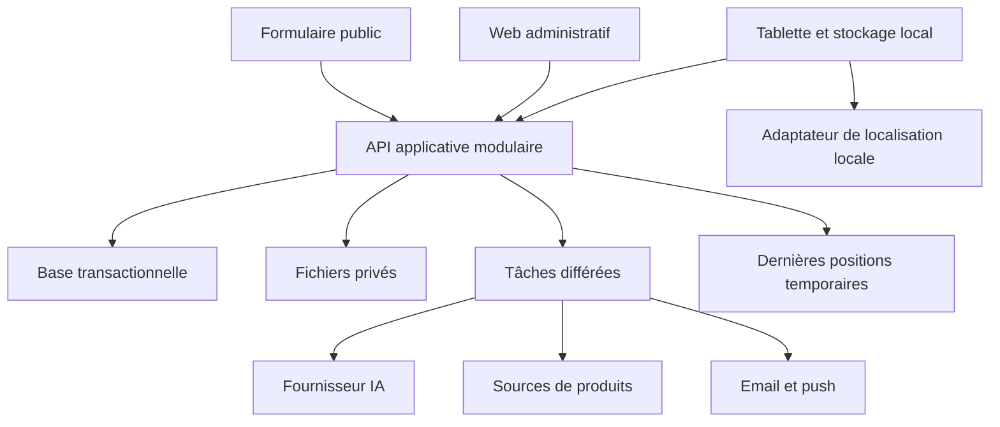

# Architecture métier et logicielle
Statut : proposition de l’architecte/tech lead, à approuver avant implémentation.

## Capacités et frontières
Patrimoine possède composants/évaluations ; maintenance possède dossiers/interventions/inspections ; stock possède mouvements ; budget possède enveloppes/engagements/dépenses ; identité possède comptes/habilitations ; plateforme possède organisations/abonnements. IA prépare des propositions, jamais des autorisations.
Une capacité ne modifie pas directement les données privées d’une autre : utiliser ses opérations métier.

## Architecture proposée
Un backend modulaire, une base relationnelle transactionnelle, un stockage de fichiers privé et un processus de tâches différées. Applications : web administratif/public et client tablette Android/iPad avec stockage local protégé. Pas de microservices initiaux : petite équipe et transactions stock/budget à maîtriser.
Choix de langages, framework tablette, base et hébergeur non faits. La faisabilité de localisation est un critère de sélection du client mobile.

Les fournisseurs externes sont derrière des adaptateurs remplaçables. Les tâches différées sont reprises sans doubler les effets. Notifications et PDF ne bloquent pas une transaction métier déjà acceptée.

## Flux critiques
- Dépôt public : résolution serveur du site → validation → dossier et événement d’alerte atomiques → traitement notification.
- Budget : contrôle de droit et solde + réservation dans une transaction ; concurrence testée.
- Synchronisation : opération identifiée → contrôle de droit courant → version attendue → application ou conflit durable → accusé.
- Position : session autorisée → dernière position temporaire → diffusion aux seuls membres habilités ; pas d’archivage de trajet.
- Score : nouvelle évaluation → calcul selon version de règle → mise à jour des agrégats et provenance.

## Déploiement proposé
Local avec données synthétiques et adaptateurs simulés ; préproduction isolée avec petit budget de tests réels ; production séparée. Secrets, données et fournisseurs de test distincts. Répliquer les migrations et procédures de restauration en préproduction avant production.

## Référence de représentation
Les vues contexte et applications suivent l’intention des niveaux du [modèle C4](https://c4model.com/). Le diagramme ci-dessus est une vue logique simplifiée, pas une architecture déjà déployée.

