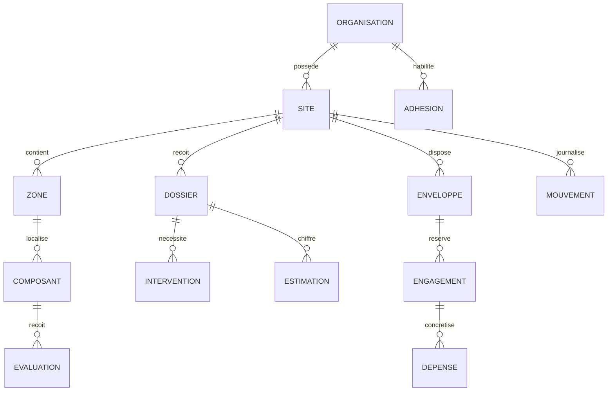

# Modèle conceptuel et contraintes
Statut : proposition de conception ; aucun schéma physique ni migration produit.

## Agrégats proposés
- Identité : compte global, adhésion à organisation, rôles et sites attribués, appareil, profil local.
- Patrimoine : bâtiments/niveaux/zones, composants, catégories, grilles versionnées, évaluations et pièces jointes.
- Maintenance : dossier (incident/besoin), déclarant, événements, interventions, périodes d’attente, inspections et occurrences.
- Finance : estimation révisée/lignes/sources, décision technique, enveloppe périodique, autorisation, engagement, exception finance, dépenses.
- Stock : article/unité/site, mouvements immuables, transfert et quantités expédiées/reçues.
- Plateforme : demande d’ouverture, abonnement, autorisation temporaire de support.
- Synchronisation : opération identifiée, version source, résultat, conflit et décision d’arbitrage.

## Contraintes
Toute référence métier conserve la même organisation ; une référence étrangère est refusée même si son identifiant existe.
Une évaluation référence sa grille exacte, pas seulement la dernière grille. Une estimation envoyée reste reproductible avec ses sources et sa version.
Une autorisation exceptionnelle référence un unique dossier. Le disponible proposé = enveloppe − dépenses imputées − engagements restants ; ne pas compter une dépense deux fois.
Une sortie de stock ne supprime pas le mouvement original ; correction par mouvement justifié.
Les fichiers ont métadonnées d’appartenance et autorisation, pas seulement une URL.
Les positions temporaires n’entrent pas dans les tables d’historique ni les sauvegardes métier.

## Arbitrages
Cardinalité de la zone des composants partagés, traitement des lots, cycles budgétaires et suppression/archivage doivent être arrêtés avant schéma physique.

