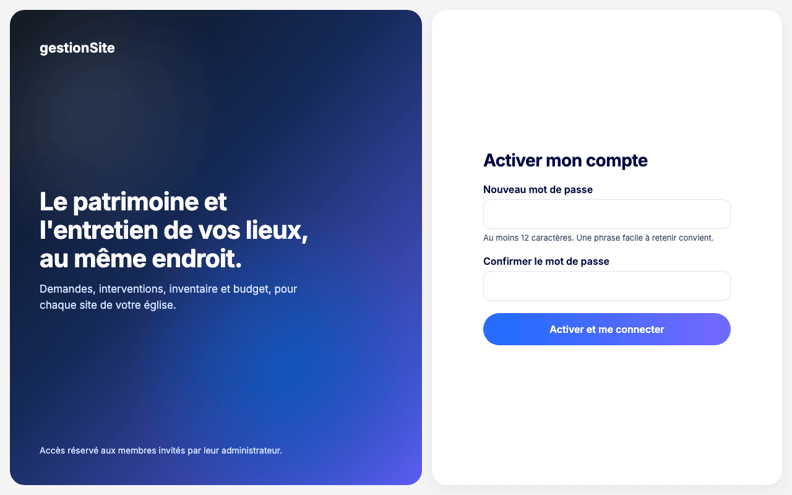
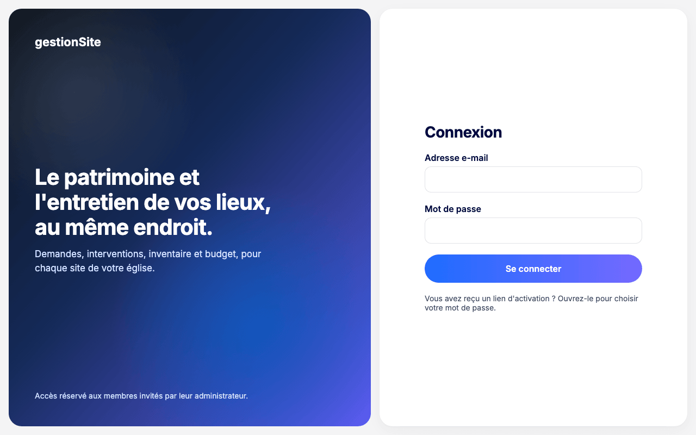

# 2. Connexion et activation {#connexion}

## Activer son compte {#connexion-activer}

**Pour qui :** toute personne invitée par l'administrateur.

Vous recevez de votre administrateur un **lien d'activation**. Il est valable 72 heures et ne sert qu'une fois.

1. Ouvrez le lien d'activation. L'écran **Activer mon compte** s'affiche.
2. Saisissez un **Nouveau mot de passe** d'au moins 12 caractères. Une phrase facile à retenir convient.
3. Saisissez-le une seconde fois dans **Confirmer le mot de passe**.
4. Cliquez sur **Activer et me connecter**.

**Ce que vous voyez ensuite :** l'application s'ouvre sur l'écran utile à votre rôle : **Dossiers** pour l'équipe d'un site, **Membres** pour l'administrateur.

**Erreurs fréquentes**

| Message | Que faire |
| --- | --- |
| « Le mot de passe doit contenir au moins 12 caractères. » | Allongez le mot de passe. |
| « Les deux mots de passe ne sont pas identiques. » | Saisissez deux fois le même mot de passe. |
| « Lien expiré ou déjà utilisé. » | Le lien a plus de 72 heures ou a déjà servi. Demandez un nouveau lien à votre administrateur. |

## Se connecter {#connexion-se-connecter}

**Pour qui :** tout membre dont le compte est activé.

1. Ouvrez l'adresse de gestionSite. L'écran **Connexion** s'affiche.
2. Saisissez votre **Adresse e-mail** et votre **Mot de passe**.
3. Cliquez sur **Se connecter**.

**Erreurs fréquentes**

| Message | Que faire |
| --- | --- |
| « E-mail ou mot de passe incorrect. » | Vérifiez l'adresse et le mot de passe (majuscules, clavier). |
| « Compte temporairement verrouillé. » | Après plusieurs essais incorrects, le compte est bloqué 15 minutes. Attendez, puis réessayez. |
| « Service momentanément indisponible. » | L'application redémarre après une période sans activité. Patientez quelques secondes et réessayez. |

## Mot de passe oublié {#connexion-mot-de-passe-oublie}

**Pour qui :** tout membre dont le compte est activé.

Sur l'écran **Connexion**, le lien **Mot de passe oublié ?** ouvre la page **Mot de passe oublié**.

> **Pas encore disponible.** L'envoi du lien par e-mail n'est pas encore en service : la page l'indique (« La réinitialisation par e-mail n'est pas encore en service. ») et son bouton **Recevoir un lien** est inactif. En attendant, demandez un **lien de réinitialisation** à l'administrateur de votre organisation (voir [Créer un lien de réinitialisation](03-administration.md#administration-reinitialisation)).

<!-- capture à ajouter après déploiement : page « Mot de passe oublié » -->

Avec le lien transmis par votre administrateur :

1. Ouvrez le lien. L'écran **Nouveau mot de passe** s'affiche.
2. Saisissez un **Nouveau mot de passe** d'au moins 12 caractères, puis **Confirmer le mot de passe**.
3. Cliquez sur **Enregistrer et me connecter**.

**À savoir**

- Le lien vaut **1 heure** et ne sert qu'une fois.
- Vos **autres appareils sont déconnectés** (dans les 15 minutes au plus) : ordinateurs, téléphones et tablettes devront se reconnecter avec le nouveau mot de passe.
- Un compte verrouillé après trop d'essais est débloqué par le nouveau mot de passe.

<!-- capture à ajouter après déploiement : écran « Nouveau mot de passe » -->

**Erreurs fréquentes**

| Message | Que faire |
| --- | --- |
| « Le mot de passe doit contenir au moins 12 caractères. » | Allongez le mot de passe. |
| « Les deux mots de passe ne sont pas identiques. » | Saisissez deux fois le même mot de passe. |
| « Lien expiré ou déjà utilisé. » | Le lien a plus d'une heure, a déjà servi, ou votre compte a rejoint une autre organisation entre-temps. Demandez un nouveau lien à votre administrateur ; s'il ne peut pas le créer, contactez l'équipe du projet. |
| « Votre mot de passe est changé. Connectez-vous avec votre nouveau mot de passe. » | Le mot de passe est enregistré, mais la connexion automatique n'a pas abouti : connectez-vous normalement. |

## Se déconnecter {#connexion-se-deconnecter}

**Pour qui :** tout le monde.

1. Cliquez sur **Se déconnecter**, en bas du menu (en haut sur téléphone).
2. L'écran **Connexion** s'affiche.

La déconnexion efface aussi les données gardées sur l'appareil, comme un brouillon de plan non enregistré. Sur un appareil partagé, déconnectez-vous toujours en partant.

## Plusieurs organisations {#connexion-organisations}

Un même compte peut appartenir à plusieurs organisations, avec le même mot de passe. Après la connexion, l'application ouvre la première organisation où vous avez un rôle.

### Accepter ou refuser une invitation {#connexion-invitation}

**Pour qui :** toute personne qui a déjà un compte et qu'une autre organisation invite.

Aucun lien d'activation n'est créé pour un compte existant : l'invitation vous attend dans l'application. Une carte **« Nom de l'organisation » vous invite** s'affiche en tête de l'écran, au-dessus de votre travail habituel. Elle indique la date, qui vous invite et les rôles proposés site par site.

- Cliquez sur **Accepter l'invitation**. Le message « Vous avez rejoint … » s'affiche ; choisissez **Ouvrir …** pour aller dans la nouvelle organisation, ou **Rester sur …**.
- Ou cliquez sur **Refuser…**, puis **Refuser l'invitation**. Vous n'aurez aucun accès à cette organisation ; pour la rejoindre plus tard, il faudra une nouvelle invitation.

Tant que vous ne répondez pas, la carte reste en tête à chaque connexion. Si vous n'avez encore aucune organisation, l'accueil affiche **Invitations** avec la même carte.

<!-- capture à ajouter après déploiement : carte d'invitation en tête de l'application -->

**Erreurs fréquentes**

| Message | Que faire |
| --- | --- |
| « L'invitation a été modifiée entre-temps. » | L'administrateur a changé les rôles proposés : relisez la carte, puis répondez. |
| « Cette invitation n'est plus valable. » | L'organisation l'a annulée. Rien n'a changé pour votre compte. |

### Changer d'organisation {#connexion-changer-organisation}

**Pour qui :** toute personne membre de deux organisations ou plus.

En haut du menu, sous **gestionSite**, le cadre **Organisation** affiche l'organisation ouverte. Cliquez dessus : la liste de vos autres organisations s'affiche. Cliquez sur l'une d'elles pour l'ouvrir sur l'écran utile à votre rôle. Avec une seule organisation, seul son nom est affiché.

<!-- capture à ajouter après déploiement : sélecteur d'organisation du menu -->
