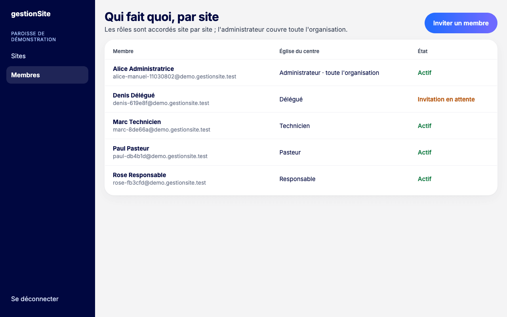
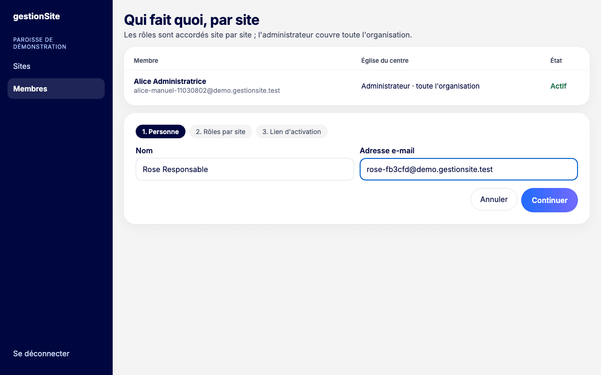
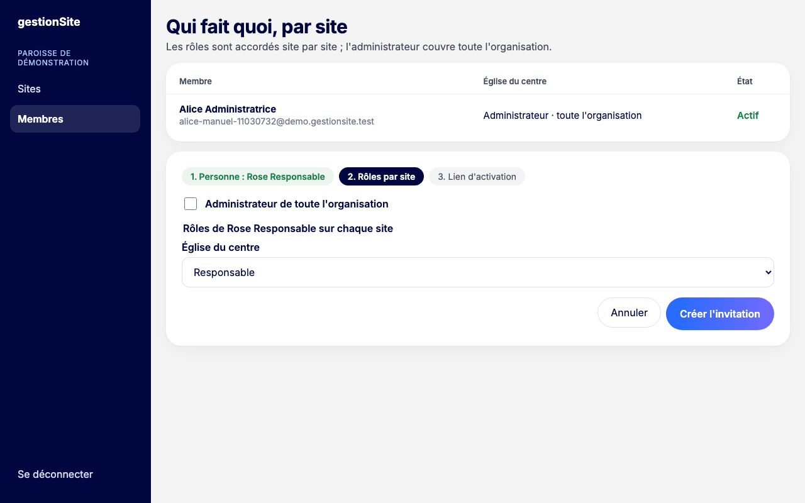
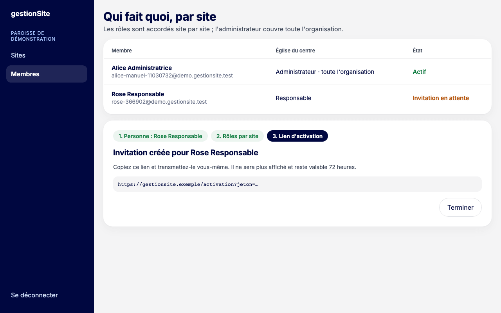
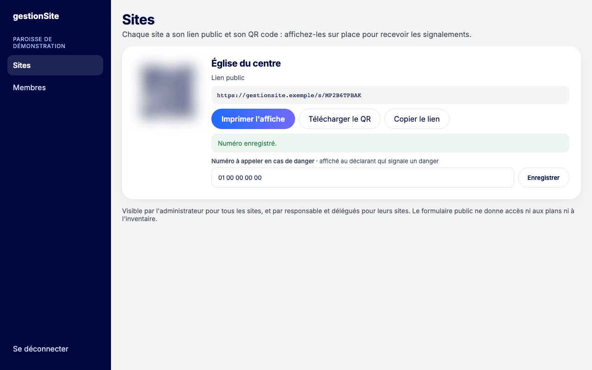

# 3. Administration {#administration}

## Voir qui fait quoi {#administration-membres}

**Pour qui :** administrateur.

**Où cliquer :** menu **Membres**.

L'écran **Qui fait quoi, par site** liste les membres de l'organisation. Pour chaque membre, vous voyez :

- son nom et son adresse e-mail ;
- son rôle sur chaque site (une colonne par site), ou « Administrateur · toute l'organisation » ;
- son **État** : **Actif** (compte activé) ou **Invitation en attente** (lien pas encore utilisé) ;
- la mention **+ plans** sur un site où il a reçu nommément le droit de modifier les plans.

Cliquez sur le nom d'un membre pour ouvrir son panneau (voir [Gérer un membre](#administration-gerer-membre)). L'onglet **Journal**, à côté de **Qui fait quoi**, affiche le [journal des habilitations](#administration-journal).

## Gérer un membre {#administration-gerer-membre}

**Pour qui :** administrateur.

**Où cliquer :** menu **Membres**, puis le nom du membre.

Un panneau s'ouvre à droite de l'écran (en bas sur tablette), la liste restant visible derrière. Il a trois onglets : **Rôles**, **Plans** et **Accès**. Chaque action s'enregistre à part, avec **son propre motif** : le motif est obligatoire et inscrit au journal des habilitations avec votre nom. Fermez le panneau avec **✕** ou **Fermer**.

### Modifier ses rôles {#administration-roles}

1. Onglet **Rôles** : pour chaque site, choisissez son rôle ou **Aucun rôle**. Cochez ou décochez **Administrateur de toute l'organisation**.
2. Saisissez le **Motif**.
3. Cliquez sur **Enregistrer les rôles**. Le message « Accès de … enregistrés. Ils s'appliquent dès sa prochaine action. » s'affiche.

**À savoir**

- Retirer son rôle sur un site lui retire aussi son droit « modifier les plans » de ce site, dans la même entrée du journal. Le panneau le signale sous le site.
- Si des interventions ou des contrôles ouverts lui sont confiés sur un site, le panneau les compte sous ce site. Rien n'est changé : après le retrait, un responsable du site doit les réaffecter.
- Une personne qui a plusieurs rôles sur un même site garde l'option combinée (par exemple **Responsable + Pasteur**).
- Vous ne pouvez pas retirer votre propre rôle d'administrateur : un autre administrateur doit le faire. Vos rôles de site restent modifiables.

<!-- capture à ajouter après déploiement : panneau d'un membre, onglet Rôles -->

**Erreurs fréquentes**

| Message | Que faire |
| --- | --- |
| « Indiquez le motif : il est inscrit au journal des habilitations. » | Saisissez le motif. |
| « Les accès de … ont changé depuis l'ouverture de cette page. » | Un autre administrateur a modifié ce membre. Rien n'a été enregistré ; ses accès actuels sont affichés et votre motif est conservé : refaites votre changement. |
| « L'organisation doit garder au moins un administrateur. » | Nommez d'abord un autre administrateur actif, puis recommencez. |
| « Gardez au moins un rôle, ou révoquez son accès dans l'onglet Accès. » | Un membre a au moins un rôle. Pour lui retirer tout accès, révoquez-le. |
| « Vous ne pouvez pas retirer votre propre rôle d'administrateur : un autre administrateur doit le faire. » | Demandez-le à un autre administrateur. |
| « Le motif doit tenir sur une ligne, 200 caractères au plus. » | Raccourcissez le motif. |

### Accorder ou retirer le droit « modifier les plans » {#administration-droit-plans}

Responsables et délégués modifient déjà les plans par leur rôle. L'administrateur peut accorder ce droit, site par site, à un technicien, un pasteur ou une personne de la coordination du site (voir [Plans de bâtiment](09-plans.md#plans)).

1. Onglet **Plans** : chaque site affiche le rôle du membre et l'état du droit (« inclus dans son rôle », « accordé le … par … », ou « Pas de rôle sur ce site »).
2. Cliquez sur l'interrupteur du site. Un encadré **Accorder sur …** (ou **Retirer à … le droit de modifier les plans de … ?**) s'ouvre.
3. Saisissez le **Motif**, puis cliquez sur **Accorder le droit** (ou **Retirer le droit**). Le message « Droit « modifier les plans » accordé à … » (ou retiré) s'affiche.

Le retrait vaut dès sa prochaine action ; ses versions de plan déjà enregistrées restent dans l'historique du plan. Le droit attend l'acceptation de l'invitation. Vous pouvez vous l'accorder à vous-même si vous avez un rôle sur le site : c'est inscrit au journal à votre nom.

<!-- capture à ajouter après déploiement : onglet Plans -->

| Message | Que faire |
| --- | --- |
| « Droit non accordé. » | Le membre n'a plus de rôle sur ce site ou n'a pas encore accepté son invitation. Rechargez la page pour voir ses rôles actuels. |

### Révoquer un accès ou annuler une invitation {#administration-revoquer}

1. Onglet **Accès**, cliquez sur **Révoquer l'accès…** (ou **Annuler l'invitation…** pour une invitation en attente).
2. Lisez les conséquences : la personne perd l'accès à l'organisation dès sa prochaine action, même connectée ; elle reste connectée pour ses autres organisations ; son droit « modifier les plans » est retiré ; son historique est conservé.
3. Si des interventions ou des contrôles ouverts lui sont confiés, un avertissement les compte. Ils restent à son nom : un responsable du site doit les réaffecter.
4. Saisissez le **Motif**, puis cliquez sur **Révoquer l'accès** (ou **Annuler l'invitation**).

Le message « Accès révoqué. La personne n'apparaît plus dans la liste ; l'opération figure au journal. » (ou « Invitation annulée. L'opération figure au journal. ») s'affiche. Vous ne pouvez pas révoquer votre propre accès : un autre administrateur doit le faire.

<!-- capture à ajouter après déploiement : confirmation de la révocation -->

| Message | Que faire |
| --- | --- |
| « Ce membre n'existe plus ou a déjà été révoqué. Rechargez la liste. » | Un autre administrateur l'a déjà révoqué : rechargez l'écran **Membres**. |

### Créer un nouveau lien d'activation {#administration-nouveau-lien}

Pour une invitation en attente dont le lien a expiré (72 heures) ou n'a pas été reçu : onglet **Accès**, **Nouveau lien d'activation**. Le lien s'affiche une seule fois : copiez-le et transmettez-le vous-même. L'ancien lien ne sert plus. L'opération figure au journal.

| Message | Que faire |
| --- | --- |
| « Pas de nouveau lien : son compte existait déjà (l'invitation l'attend dans son espace) ou a déjà été activé. » | La personne a déjà un compte : elle accepte l'invitation dans l'application (voir [Accepter une invitation](02-connexion.md#connexion-invitation)). |

### Créer un lien de réinitialisation {#administration-reinitialisation}

Tant que l'envoi par e-mail n'est pas en service, vous pouvez aider un membre actif qui a oublié son mot de passe. Ce n'est pas possible pour un autre administrateur : son lien passe par l'équipe du projet (l'onglet le dit à la place du bouton).

1. Onglet **Accès**, rubrique **Mot de passe de …**, cliquez sur **Créer un lien de réinitialisation**.
2. Le lien s'affiche une seule fois. Copiez-le et transmettez-le vous-même à la personne. Il vaut **1 heure** et ne sert qu'une fois ; un nouveau lien annule le précédent.

La personne choisit alors un nouveau mot de passe (voir [Mot de passe oublié](02-connexion.md#connexion-mot-de-passe-oublie)) ; tous ses appareils sont déconnectés. La création du lien et son usage sont inscrits au journal. La rubrique n'apparaît pas dans votre propre panneau.

| Message | Que faire |
| --- | --- |
| « Le mot de passe d'un administrateur ne se réinitialise pas depuis cet écran : adressez-vous à l'équipe du projet. » | La personne est administrateur : contactez l'équipe du projet. |
| « Lien impossible pour ce compte : il doit avoir été créé par votre organisation et n'être lié à aucune autre. » | Le compte a été créé par une autre organisation, ou appartient aussi à une autre organisation (invitation en attente comprise) : adressez-vous à l'équipe du projet. |

## Journal des habilitations {#administration-journal}

**Pour qui :** administrateur.

**Où cliquer :** menu **Membres**, onglet **Journal**.

Le journal liste, du plus récent au plus ancien, chaque changement d'accès : invitation créée, acceptée ou refusée, rôles modifiés (avant et après), droit « plans » accordé ou retiré, accès révoqué, nouveau lien d'activation, lien de réinitialisation créé, mot de passe réinitialisé. Chaque entrée indique la date et l'heure, la personne concernée, qui a agi et le motif. **Entrées plus anciennes** affiche la suite.

L'historique d'une seule personne est dans son panneau, onglet **Accès**, rubrique **Historique de ses accès**.

<!-- capture à ajouter après déploiement : onglet Journal -->

## Inviter un membre {#administration-inviter}

**Pour qui :** administrateur.

**Où cliquer :** menu **Membres**, puis **Inviter un membre**.

L'invitation se fait en trois étapes.

1. **Personne** : saisissez le **Nom** et l'**Adresse e-mail** du nouveau membre, puis cliquez sur **Continuer**.

   

2. **Rôles par site** : choisissez son rôle sur chaque site (**Technicien**, **Responsable**, **Délégué**, **Pasteur** ou **Coordination**), ou laissez **Aucun rôle**. Pour un administrateur, cochez **Administrateur de toute l'organisation**. Cliquez sur **Créer l'invitation**.

   

3. **Lien d'activation** : l'application affiche le lien. Copiez-le et transmettez-le vous-même à la personne (message, e-mail). Cliquez sur **Terminer**.

   

**À savoir**

- Le lien n'est affiché qu'une fois. Il reste valable 72 heures.
- L'application n'envoie aucun e-mail : c'est vous qui transmettez le lien.
- Le nouveau membre apparaît avec l'état **Invitation en attente** jusqu'à l'activation de son compte.
- Si la personne a déjà un compte gestionSite, aucun lien n'est créé : le message indique que l'invitation l'attend dans son espace.
- Un technicien doit avoir activé son compte avant qu'on puisse lui confier une intervention.

**Erreurs fréquentes**

| Message | Que faire |
| --- | --- |
| « Le nom et l'adresse e-mail sont obligatoires. » | Remplissez les deux champs. |
| « Choisissez au moins un rôle, ou l'administration de toute l'organisation. » | Attribuez un rôle sur au moins un site. |
| « Cette personne est déjà membre ou invitée. » | Elle figure déjà dans la liste. |
| « Ce compte n'est pas encore activé : réessayez après son activation. » | La personne a un compte en attente d'activation : attendez qu'elle l'active. |
| « Adresse e-mail invalide. » | Corrigez l'adresse. |

## Ajouter un site {#administration-ajouter-site}

**Pour qui :** administrateur seulement.

**Où cliquer :** menu **Sites**, puis **Ajouter un site**.

1. **Nom du site** : saisissez le nom (il figure sur l'affiche et sur le formulaire public), puis cliquez sur **Créer le site**.
2. **Lien public et QR code** : le site est créé avec son lien public et son QR code. Vous pouvez **Imprimer l'affiche**, **Télécharger le QR** ou **Copier le lien**.

La rubrique **À faire ensuite** rappelle la suite : saisir le **numéro à appeler en cas de danger** (**Saisir le numéro**), **donner des rôles sur ce site** (**Ouvrir Membres** ; sans responsable, les signalements ne sont pas traités), puis faire décrire les bâtiments dans l'inventaire. Cliquez sur **Terminer** pour revenir à la liste des sites.

Renommer ou fermer un site n'est pas encore possible.

<!-- capture à ajouter après déploiement : étape 2 de l'ajout d'un site -->

**Erreurs fréquentes**

| Message | Que faire |
| --- | --- |
| « Saisissez le nom du site. » | Le nom est obligatoire. |
| « Un site porte déjà ce nom dans l'organisation. Choisissez un autre nom. » | Les majuscules, accents et tirets ne comptent pas : « chapelle saint roch » vaut « Chapelle Saint-Roch ». Choisissez un nom distinct. |
| « Le nom doit tenir sur une ligne, 200 caractères au plus. » | Raccourcissez le nom. |

## Afficher le lien public et le QR code d'un site {#administration-sites}

**Pour qui :** administrateur (tous les sites), responsable et délégué (leurs sites).

**Où cliquer :** menu **Sites**.

Chaque site a un **lien public** et un **QR code**. Ils permettent à n'importe qui de signaler un problème sans compte (voir le chapitre [Dépôt public](04-depot-public.md#depot)). Le formulaire public ne donne accès ni aux plans ni à l'inventaire.

Sur la carte du site, vous pouvez :

- **Imprimer l'affiche** : ouvre une affiche A4 prête à imprimer ;
- **Télécharger le QR** : enregistre l'image du QR code (pour un bulletin, un écran) ;
- **Copier le lien** : copie l'adresse du formulaire public.

Sur les images de ce manuel, le QR code est volontairement flou.

## Saisir le numéro à appeler en cas de danger {#administration-numero-urgence}

**Pour qui :** administrateur seulement.

**Où cliquer :** menu **Sites**, champ **Numéro à appeler en cas de danger**.

1. Saisissez le numéro (chiffres, espaces, +, point, tiret ou parenthèses).
2. Cliquez sur **Enregistrer**. Le message « Numéro enregistré. » s'affiche.

Ce numéro est montré à la personne qui signale un danger avec le formulaire public, après le rappel d'appeler les secours (18 ou 112). Sans numéro, la mention « Non renseigné : aucune consigne affichée » apparaît.

Les responsables et délégués voient le numéro mais ne peuvent pas le modifier.

## Imprimer l'affiche du site {#administration-affiche}

**Pour qui :** administrateur, responsable, délégué.

1. Menu **Sites**, puis **Imprimer l'affiche** sur la carte du site. L'affiche s'ouvre dans un nouvel onglet.
2. Cliquez sur **Imprimer**. Choisissez le format A4, portrait.
3. Affichez-la à l'entrée et dans les lieux de passage.

L'affiche porte le nom de l'organisation et du site, le QR code, trois consignes et l'adresse du formulaire pour ceux qui n'ont pas de lecteur de QR code.

