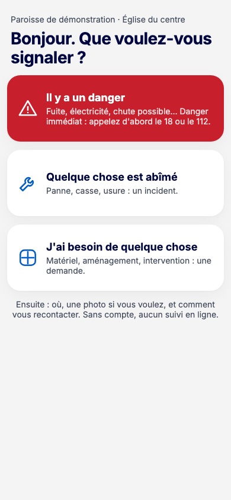
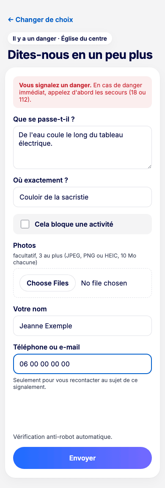

# 4. Dépôt public par QR code {#depot}

Le dépôt public permet à toute personne (fidèle, visiteur, prestataire) de signaler un problème **sans compte**. Elle scanne le QR code affiché sur place ou ouvre le lien public du site.

## Signaler un problème (vu du fidèle) {#depot-signaler}

**Pour qui :** toute personne présente sur le site, sans compte.

1. Scannez le QR code de l'affiche avec l'appareil photo du téléphone, ou ouvrez l'adresse écrite en bas de l'affiche.
2. L'écran **Bonjour. Que voulez-vous signaler ?** propose trois choix :
   - **Il y a un danger** : fuite, électricité, chute possible ;
   - **Quelque chose est abîmé** : panne, casse, usure (un incident) ;
   - **J'ai besoin de quelque chose** : matériel, aménagement, intervention (une demande).

   

3. Remplissez le formulaire **Dites-nous en un peu plus** :
   - **Que se passe-t-il ?** : décrivez le problème ;
   - **Où exactement ?** : l'endroit précis ;
   - **Cela bloque une activité** : cochez si c'est le cas ;
   - **Photos** : facultatives, 3 au plus (JPEG, PNG ou HEIC, 10 Mo chacune) ;
   - **Votre nom** et **Téléphone ou e-mail** : seulement pour vous recontacter.

   

4. Cliquez sur **Envoyer**. Une vérification anti-robot se fait automatiquement.
5. Le message **Merci, c'est transmis.** confirme l'envoi. Vous pouvez fermer la page ou cliquer sur **Faire un autre signalement**.

**À savoir**

- **Danger immédiat : appelez d'abord les secours (18 ou 112).** Le formulaire le rappelle. Après l'envoi d'un danger, il affiche aussi le numéro d'urgence du site, s'il a été renseigné.
- Il n'y a pas de suivi en ligne. L'équipe d'entretien vous recontacte si besoin.
- Les informations de localisation des photos (position GPS) sont retirées à la réception.

**Erreurs fréquentes**

| Message | Que faire |
| --- | --- |
| « Ce lien n'est pas valable » | Vérifiez l'adresse affichée sur place ou scannez de nouveau le QR code. |
| « Photos : 3 au plus, de 10 Mo chacune… » | Retirez une photo ou choisissez une photo plus légère. Votre saisie est conservée ; joignez de nouveau vos photos. |
| « La vérification anti-robot n'a pas abouti » | Réessayez. Votre saisie est conservée. |
| « Trop d'envois depuis votre connexion » | Réessayez dans quelques minutes. |
| « Service momentanément indisponible » | Réessayez dans un instant. |

## Recevoir les signalements (dépôts reçus) {#depot-recus}

**Pour qui :** équipe du site (technicien, responsable, délégué, pasteur, coordination).

**Où cliquer :** menu **Dépôts reçus** pour la liste des signalements reçus ; menu **Dossiers** pour les traiter.

L'écran **Dépôts reçus** liste, du plus récent au plus ancien, les signalements envoyés depuis le lien public ou le QR code du site. Il est en lecture seule.

- Chaque ligne indique **Reçu le**, le **Type** (**Incident** ou **Demande**, avec les étiquettes **Danger** et **Bloque une activité** le cas échéant), **Où** (l'emplacement écrit par le déclarant), la **Description** et le nombre de **Photos**.
- Cliquez sur la date d'un signalement pour afficher son détail à droite : description, photos, **Déclarant**, **Contact** avec la mention « (non vérifié) », date de réception.
- Si vous avez des rôles sur plusieurs sites, les onglets en haut de l'écran changent de site. Au-delà de 50 signalements, **Plus anciens** affiche la suite et **Les plus récents** revient au début.

Chaque signalement public devient aussi un **dossier** dans la colonne **À qualifier** du site. C'est là qu'il se traite, comme tout autre dossier : voir le chapitre [Dossiers](05-dossiers.md#dossiers).

- La zone n'est pas encore choisie : le dossier porte la mention « Zone à préciser ». Le responsable la choisit en le qualifiant.
- L'emplacement écrit par le déclarant figure dans l'onglet **Constat**.
- L'onglet **Déclarant** montre le nom et le contact laissés par la personne, avec la mention « (non vérifié) ».
- Un danger signalé apparaît en rouge avec l'étiquette **Danger**.

Les coordonnées des déclarants sont des données personnelles. Utilisez-les seulement pour le suivi du signalement.

> **Pas encore disponible.** Aucune alerte n'est envoyée à l'arrivée d'un signalement, même pour un danger. Consultez régulièrement l'écran **Dossiers**.
