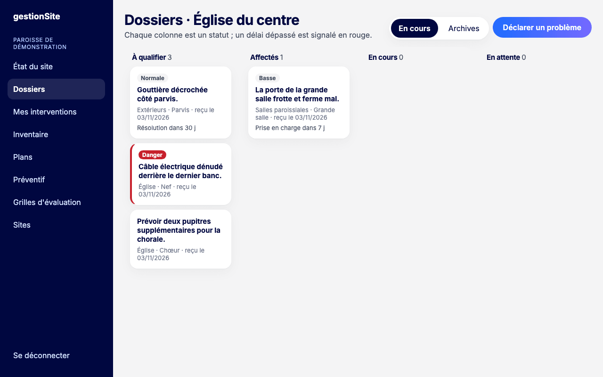
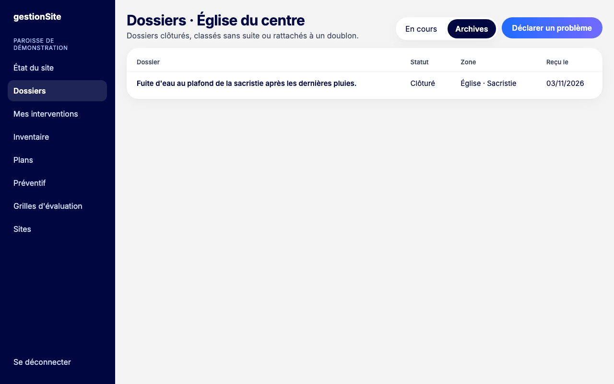
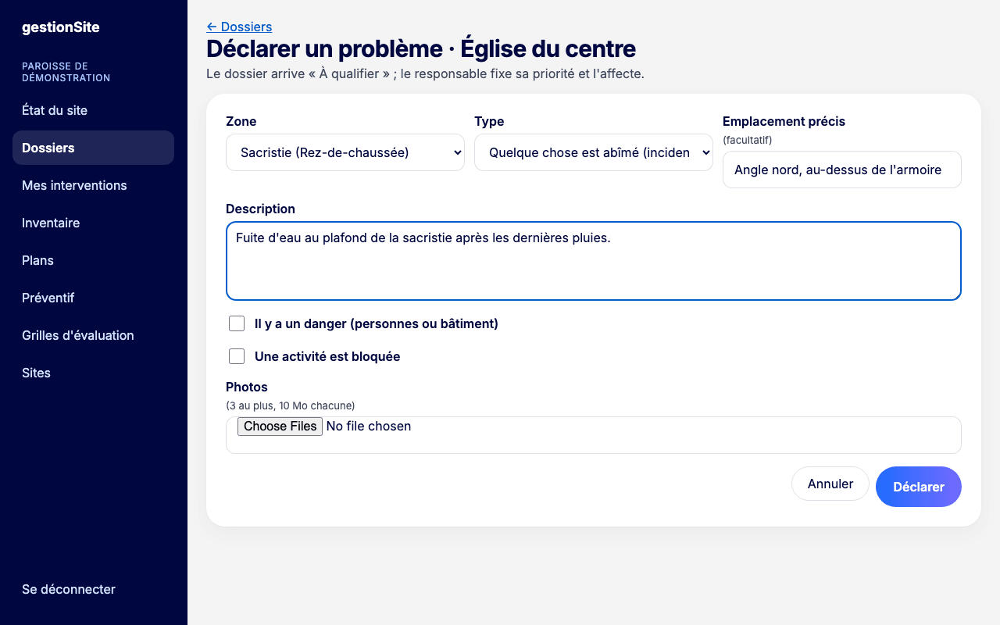
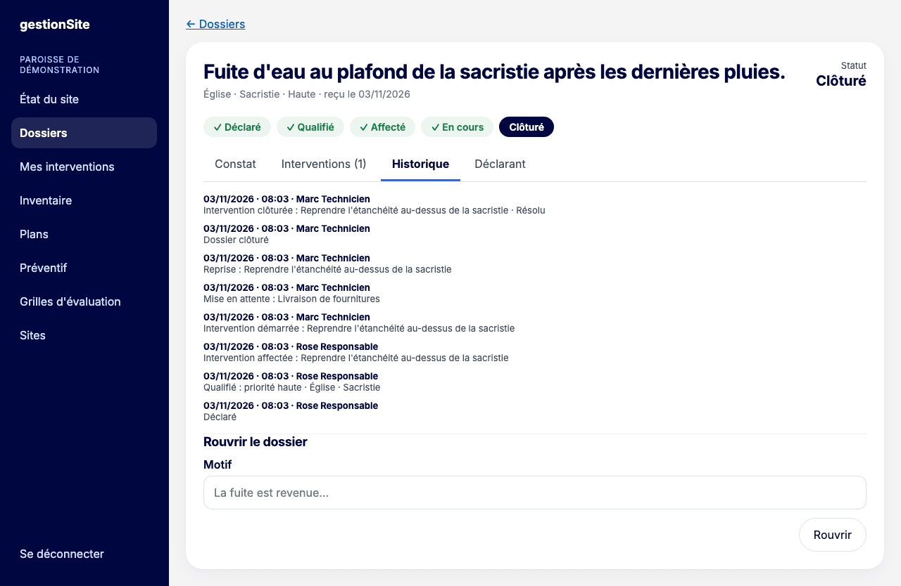
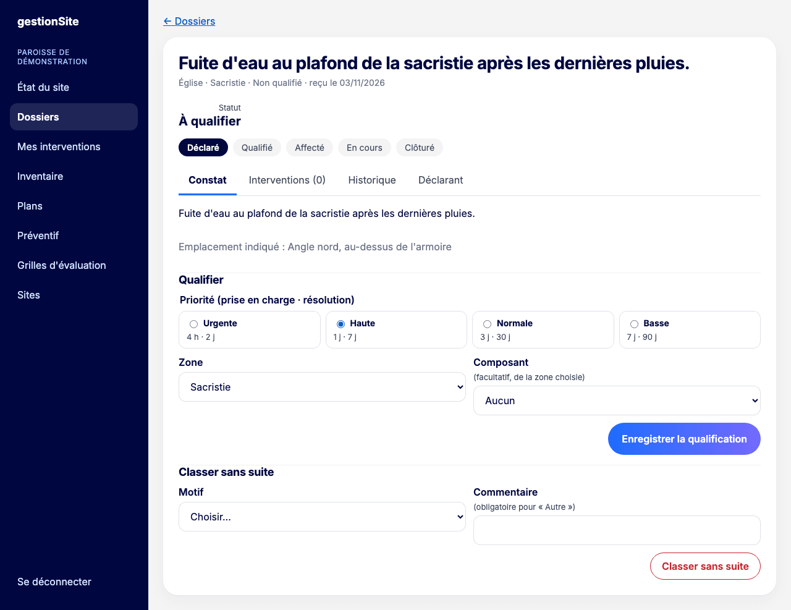
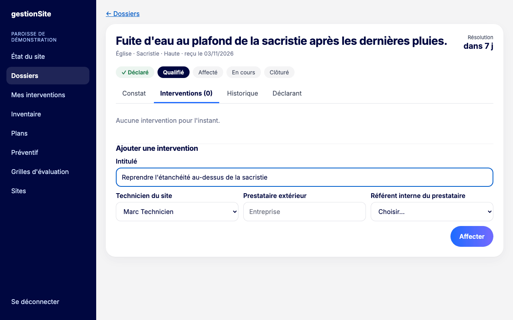
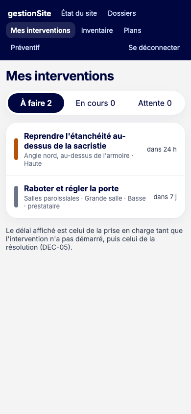
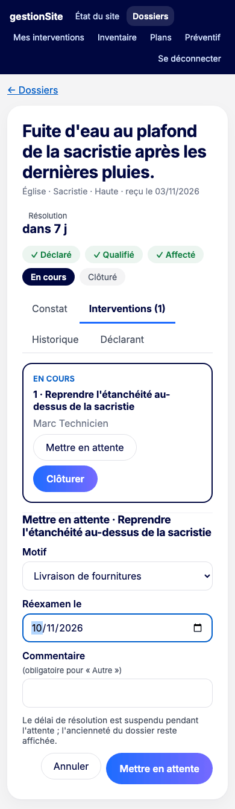
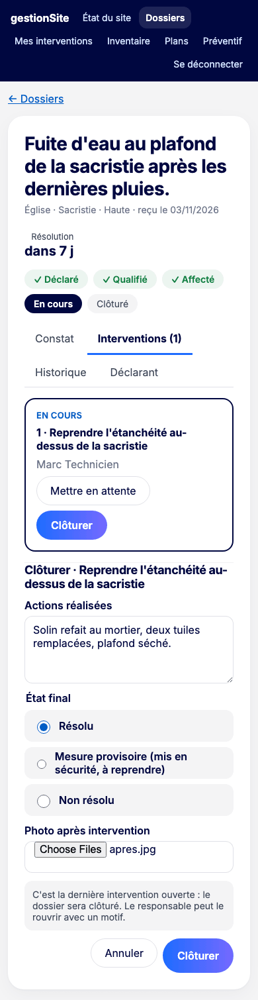

# 5. Dossiers {#dossiers}

Un **dossier** suit un problème ou une demande, de sa déclaration à sa clôture. Il peut contenir une ou plusieurs **interventions**, chacune confiée à un technicien ou à un prestataire.

Le cycle complet est résumé dans le chapitre [Workflows](10-workflows.md#workflows-dossier).

## Suivre les dossiers d'un site {#dossiers-suivi}

**Pour qui :** équipe du site.

**Où cliquer :** menu **Dossiers**.

L'écran montre une colonne par statut : **À qualifier**, **Affectés**, **En cours**, **En attente**. Chaque carte indique :

- la priorité (**Urgente**, **Haute**, **Normale**, **Basse**) ou l'étiquette **Danger** ;
- le titre, la zone et la date de réception ;
- « activité bloquée » si c'est le cas ;
- le délai restant (« Prise en charge dans 7 j », « Résolution dans 30 j ») ou « Délai suspendu » en attente. Un délai dépassé s'affiche en rouge : « dépassé de 2 j ».

Cliquez sur une carte pour ouvrir le dossier. L'onglet **Archives** liste les dossiers clôturés, classés sans suite ou rattachés à un doublon.

## Déclarer un problème {#dossiers-declarer}

**Pour qui :** tout membre ayant un rôle sur le site (technicien, responsable, délégué, pasteur, coordination).

**Où cliquer :** menu **Dossiers**, puis **Déclarer un problème**.

1. Choisissez la **Zone** du site.
2. Choisissez le **Type** : « Quelque chose est abîmé (incident) » ou « J'ai besoin de quelque chose (demande) ».
3. Précisez l'**Emplacement précis** si utile (facultatif).
4. Rédigez la **Description**.
5. Cochez **Il y a un danger** ou **Une activité est bloquée** si c'est le cas.
6. Ajoutez des **Photos** si utile (3 au plus, 10 Mo chacune).
7. Cliquez sur **Déclarer**.

**Ce que vous voyez ensuite :** la fiche du nouveau dossier, au statut **À qualifier**.

**Erreurs fréquentes**

- « Aucune zone n'est décrite pour ce site » : l'inventaire doit d'abord comporter au moins un bâtiment (voir [Inventaire](06-inventaire.md#inventaire-structure)).
- « Choisissez une zone du site » ou « Décrivez le problème » : un champ obligatoire est vide.

## Lire la fiche d'un dossier {#dossiers-fiche}

**Pour qui :** équipe du site.

En haut de la fiche : le titre, le lieu, la priorité, la date de réception, les étiquettes **Danger signalé** et **Activité bloquée**, et le délai en cours. La barre d'avancement montre les étapes : **Déclaré**, **Qualifié**, **Affecté**, **En cours**, **Clôturé**.

La fiche a quatre onglets :

- **Constat** : description, emplacement, photos ; les panneaux de qualification pour le responsable ;
- **Interventions** : les interventions et leurs actions ;
- **Historique** : chaque étape avec sa date, son heure et son auteur ;
- **Déclarant** : nom et contact de la personne qui a signalé le problème.

## Qualifier un dossier {#dossiers-qualifier}

**Pour qui :** responsable, délégué.

**Où cliquer :** fiche du dossier, onglet **Constat**, panneau **Qualifier**.

Qualifier, c'est fixer la priorité et le lieu exact.

1. Choisissez la **Priorité**. Chaque priorité affiche ses délais (prise en charge · résolution) :

   | Priorité | Usage | Prise en charge | Résolution |
   | --- | --- | --- | --- |
   | Urgente | Danger, activité bloquée | 4 h | 2 jours |
   | Haute | Gêne importante | 1 jour | 7 jours |
   | Normale | Cas courant | 3 jours | 30 jours |
   | Basse | Amélioration, peut attendre | 7 jours | 90 jours |

2. Choisissez la **Zone** (obligatoire).
3. Choisissez le **Composant** concerné si vous le connaissez (facultatif, parmi ceux de la zone).
4. Cliquez sur **Enregistrer la qualification**.

**À savoir**

- La priorité est indépendante du danger : un danger reste signalé à part.
- Les délais se comptent en jours calendaires, week-ends et jours fériés compris. Ce sont des objectifs de suivi.
- Le dossier reste dans la colonne **À qualifier** jusqu'à sa première intervention ; la barre d'avancement indique **Qualifié**.
- Vous pouvez modifier la qualification tant que le dossier est ouvert (panneau **Modifier la qualification**).

## Traiter un doublon {#dossiers-doublon}

**Pour qui :** responsable, délégué.

Quand un dossier **À qualifier** ressemble à un dossier déjà ouvert du même site, le panneau **Doublons possibles** le propose.

1. Vérifiez qu'il s'agit bien du même problème.
2. Cliquez sur **Rattacher à ce dossier**.

Le dossier rattaché passe aux archives avec le statut « Rattaché à un doublon ». Sa déclaration reste visible dans le dossier principal (« Doublons rattachés »).

## Classer sans suite {#dossiers-classer}

**Pour qui :** responsable, délégué.

**Où cliquer :** fiche d'un dossier **À qualifier**, onglet **Constat**, panneau **Classer sans suite**.

1. Choisissez le **Motif** : aucun problème constaté, hors périmètre, déjà traité hors application, spam ou abusif, autre.
2. Ajoutez un **Commentaire** (obligatoire pour « Autre »).
3. Cliquez sur **Classer sans suite**.

Le dossier passe aux archives. Il peut être rouvert (voir [Rouvrir un dossier](#dossiers-rouvrir)).

## Affecter une intervention {#dossiers-affecter}

**Pour qui :** responsable, délégué.

**Où cliquer :** fiche du dossier, onglet **Interventions**, panneau **Ajouter une intervention**. Le dossier doit être qualifié.

1. Donnez un **Intitulé** à l'intervention (par exemple « Remplacer la batterie du bloc »).
2. Choisissez qui intervient :
   - un **Technicien du site** ;
   - ou un **Prestataire extérieur** (nom de l'entreprise) et son **Référent interne**, le membre du site qui suit son travail.
3. Cliquez sur **Affecter**.

**Ce que vous voyez ensuite :** le dossier passe au statut **Affecté**. Le délai de prise en charge commence. L'intervention apparaît dans **Mes interventions** du technicien ou du référent.

Un dossier peut recevoir plusieurs interventions (par exemple un couvreur puis un peintre).

**Erreurs fréquentes**

- « Qualifiez le dossier (priorité et zone) avant de l'affecter. »
- « Choisissez un technicien du site, ou un prestataire et son référent. »
- « Un prestataire est suivi par un référent interne du site. »

## Mes interventions {#dossiers-mes-interventions}

**Pour qui :** technicien, responsable, délégué.

**Où cliquer :** menu **Mes interventions**.

La liste regroupe les interventions qui vous sont confiées, ou que vous suivez comme référent d'un prestataire, sur tous vos sites. Trois filtres : **À faire**, **En cours**, **Attente**. Les interventions sont rangées par priorité, puis par délai.

Le délai affiché est celui de la prise en charge tant que l'intervention n'a pas démarré, puis celui de la résolution.

Touchez une ligne pour ouvrir le dossier sur l'onglet **Interventions**.

## Démarrer une intervention {#dossiers-demarrer}

**Pour qui :** le technicien affecté, le référent du prestataire, ou un responsable ou délégué.

1. Ouvrez le dossier, onglet **Interventions**.
2. Cliquez sur **Démarrer**.

Le dossier passe **En cours**. Le délai de résolution s'affiche.

## Mettre en attente {#dossiers-attente}

**Pour qui :** le technicien affecté, le référent du prestataire, ou un responsable ou délégué.

À utiliser quand l'intervention ne peut pas avancer pour une raison extérieure.

1. Sur une intervention **En cours**, cliquez sur **Mettre en attente**.
2. Choisissez le **Motif** : financement ou accord finance, livraison de fournitures, prestataire extérieur, accès au lieu impossible, décision interne, autre.
3. Fixez la date **Réexamen le** (entre aujourd'hui et un an).
4. Ajoutez un **Commentaire** (obligatoire pour « Autre »).
5. Cliquez sur **Mettre en attente**.

**À savoir :** pendant l'attente, le délai de résolution est suspendu. L'ancienneté du dossier reste affichée.

Pour reprendre, cliquez sur **Reprendre** : l'intervention repasse **En cours**.

## Clôturer une intervention {#dossiers-cloturer}

**Pour qui :** le technicien affecté, le référent du prestataire, ou un responsable ou délégué.

1. Sur une intervention **En cours**, cliquez sur **Clôturer**.
2. Décrivez les **Actions réalisées**.
3. Choisissez l'**État final** :
   - **Résolu** ;
   - **Mesure provisoire (mis en sécurité, à reprendre)** ;
   - **Non résolu**.
4. Ajoutez une **Photo après intervention**. Elle est obligatoire quand le composant du dossier relève de l'électricité, de l'éclairage de sécurité, de la sécurité incendie, du gaz, de la couverture ou de la structure.
5. Cliquez sur **Clôturer**.

**Ce que vous voyez ensuite :** quand la dernière intervention ouverte est clôturée, le dossier est clôturé automatiquement et passe aux archives. Un message le rappelle avant l'envoi.

**Erreurs fréquentes**

- « Photo obligatoire pour ce corps d'état » : ajoutez au moins une photo.
- « Quelqu'un d'autre vient de modifier ce dossier : la fiche est rechargée, recommencez. »

## Rouvrir un dossier {#dossiers-rouvrir}

**Pour qui :** responsable, délégué.

**Où cliquer :** fiche d'un dossier **Clôturé** ou **Classé sans suite**, panneau **Rouvrir le dossier**.

1. Saisissez le **Motif** (par exemple « La fuite est revenue »).
2. Cliquez sur **Rouvrir**.

Le dossier revient **À qualifier**. L'historique garde la trace de la réouverture.

## Délais et retards {#dossiers-delais}

- **Prise en charge** : de l'affectation au démarrage de la première intervention.
- **Résolution** : jusqu'à la clôture, sans compter les périodes d'attente.
- Le délai restant s'affiche sur les cartes, dans **Mes interventions** et en haut de la fiche. En retard, il devient rouge : « dépassé de … ».

> **Pas encore disponible.** Aucun rappel ni relance n'est envoyé quand un délai approche ou est dépassé. Une prochaine version comptera la prise en charge dès la qualification et ajoutera des rappels.
