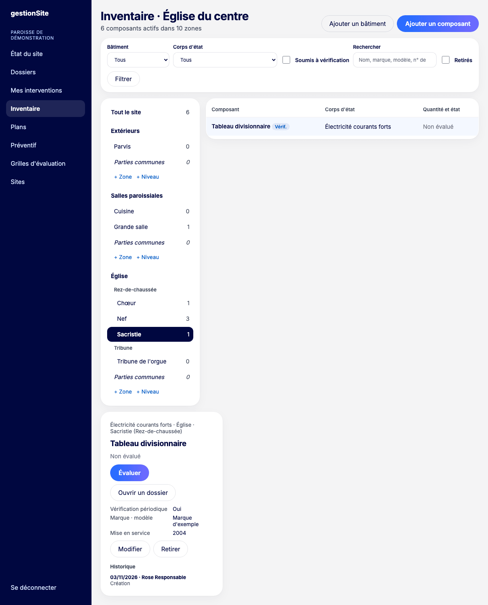
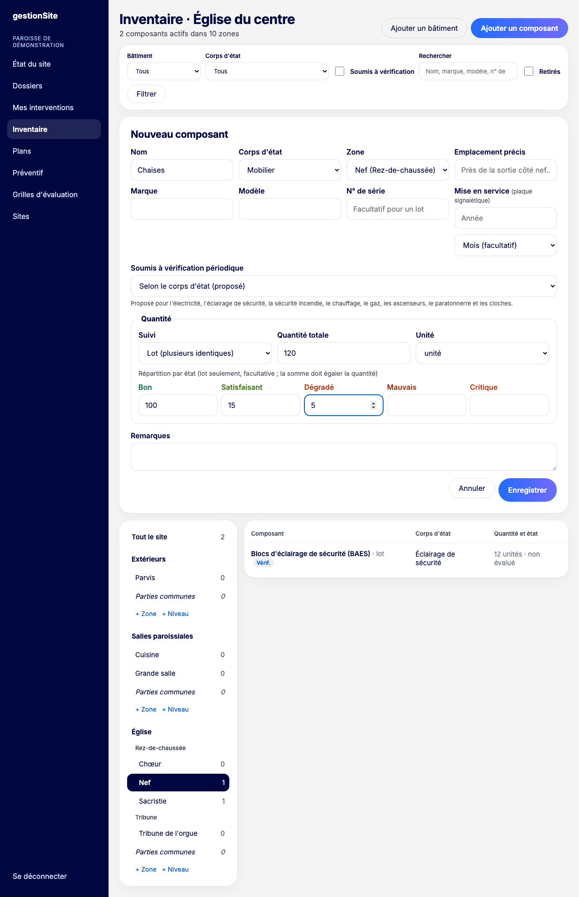

# 6. Inventaire {#inventaire}

L'inventaire décrit le site : ses bâtiments, leurs niveaux et leurs zones, puis les **composants** (équipements, éléments du bâti, matériel) rangés dans chaque zone.

**Pour qui :** tous les membres du site consultent l'inventaire. Le technicien, le responsable et le délégué le modifient. Chaque modification est tracée avec son auteur.

**Où cliquer :** menu **Inventaire**.

L'écran a trois parties :

- à gauche, l'**arborescence** : **Tout le site**, puis chaque bâtiment, ses niveaux et ses zones, avec le nombre de composants ;
- au centre, la **liste des composants** de la sélection ;
- à droite (ou en dessous), la **fiche** du composant choisi.

## Décrire la structure du site {#inventaire-structure}

L'ordre conseillé : bâtiments, puis niveaux, puis zones.

### Ajouter un bâtiment {#inventaire-batiment}

1. Cliquez sur **Ajouter un bâtiment**.
2. Saisissez le **Nom** (« Église », « Salles paroissiales »…).
3. Cliquez sur **Enregistrer**.

Chaque bâtiment reçoit automatiquement une zone **Parties communes**, pour les éléments qui servent à tout le bâtiment (toiture, tableau général…). Les extérieurs (parvis, parking, jardin) se décrivent comme un bâtiment nommé « Extérieurs ».

### Ajouter un niveau {#inventaire-niveau}

1. Sous le bâtiment, dans l'arborescence, cliquez sur **+ Niveau**.
2. Saisissez le **Nom** (« Rez-de-chaussée », « Tribune »…) et l'**Ordre** : −1 pour un sous-sol, 0 pour le rez-de-chaussée, 1 pour le premier étage.
3. Cliquez sur **Enregistrer**.

Les niveaux sont facultatifs : un petit bâtiment peut s'en passer.

### Ajouter une zone {#inventaire-zone}

1. Sous le bâtiment, cliquez sur **+ Zone**.
2. Saisissez le **Nom** (« Sacristie », « Grande salle »…).
3. Choisissez le **Niveau** (facultatif).
4. Cliquez sur **Enregistrer**.

## Ajouter un composant {#inventaire-composant}

1. Dans l'arborescence, cliquez sur la zone : elle sera proposée d'office.
2. Cliquez sur **Ajouter un composant**.
3. Remplissez la fiche :
   - **Nom** (« Extincteur CO2 2 kg », « Chaises »…) ;
   - **Corps d'état** : la famille technique (électricité, sécurité incendie, mobilier…) ;
   - **Zone** et **Emplacement précis** ;
   - **Marque**, **Modèle**, **N° de série**, **Mise en service** (année, mois facultatif), si vous les connaissez ;
   - **Soumis à vérification périodique** : proposé d'après le corps d'état (électricité, éclairage de sécurité, sécurité incendie, chauffage, gaz, ascenseurs, paratonnerre, cloches), modifiable ;
   - **Remarques**.
4. Cliquez sur **Enregistrer**.

Un composant « soumis à vérification périodique » porte le badge **Vérif.** Il sert de base aux plans proposés du [préventif](08-preventif.md#preventif-propositions).

## Suivre un lot {#inventaire-lot}

Un **lot** regroupe plusieurs objets identiques : 120 chaises, 12 blocs d'éclairage de sécurité.

1. Dans **Suivi**, choisissez **Lot (plusieurs identiques)**.
2. Indiquez la **Quantité totale** et l'**Unité** (unité, m², mètre linéaire, m³, ensemble).
3. Si vous le souhaitez, répartissez la quantité par état : **Bon**, **Satisfaisant**, **Dégradé**, **Mauvais**, **Critique**. La somme doit égaler la quantité totale.

Sans répartition, le lot est « non évalué ». Une [évaluation](07-evaluations.md#evaluations-lot) met ensuite la répartition à jour.

## Rechercher et filtrer {#inventaire-filtrer}

La barre de filtres permet de chercher par **Bâtiment**, **Corps d'état**, **Soumis à vérification**, texte (**Rechercher** : nom, marque, modèle, n° de série) et d'afficher les **Retirés**. Cliquez sur **Filtrer** ; **Effacer** revient à la liste complète.

Au-delà de 1 000 composants, seuls les premiers sont affichés : affinez avec les filtres.

## Modifier ou retirer un composant {#inventaire-modifier}

**Modifier :** sur la fiche, cliquez sur **Modifier**, corrigez, puis **Enregistrer**.

**Retirer** (composant déposé, remplacé, cédé, détruit) :

1. Sur la fiche, cliquez sur **Retirer**.
2. Saisissez le **Motif du retrait**.
3. Cliquez sur **Retirer de l'inventaire**.

Le retrait est **définitif**. Le composant sort de l'inventaire actif et du calcul de la note, mais son historique reste consultable (filtre **Retirés**).

## Historique d'un composant {#inventaire-historique}

En bas de la fiche, l'**Historique** liste chaque création, modification et retrait, avec la date et l'auteur. Les évaluations ont leur propre liste (voir [Évaluations](07-evaluations.md#evaluations)).

**Erreurs fréquentes**

| Message | Que faire |
| --- | --- |
| « Quelqu'un d'autre vient de modifier ce composant : rechargez la fiche puis recommencez. » | Une autre personne a enregistré entre-temps. Rechargez et refaites votre modification. |
| « Ce composant est retiré : il ne se modifie plus. » | Un composant retiré reste en lecture seule. |
| « Vous ne modifiez pas l'inventaire de ce site. » | Votre rôle sur ce site ne permet que la consultation. |
