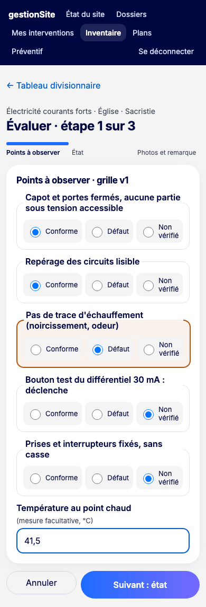
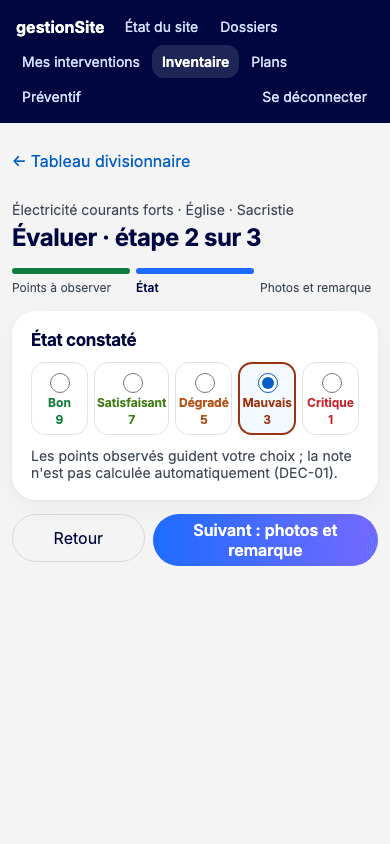
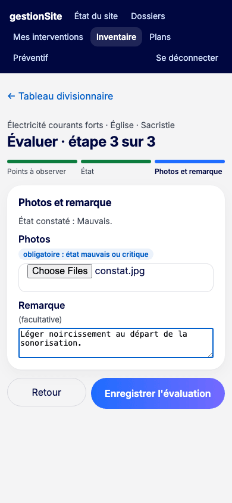
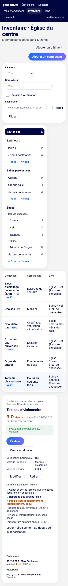
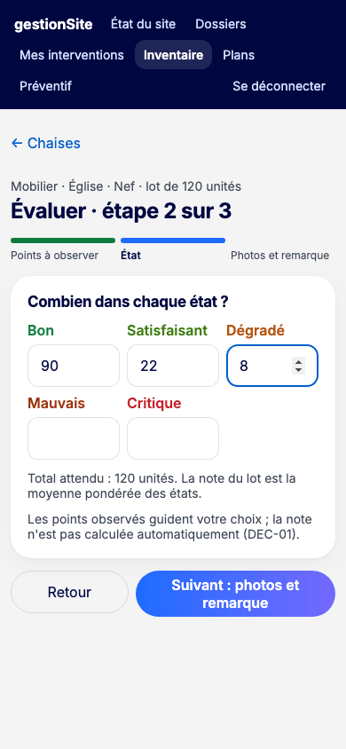
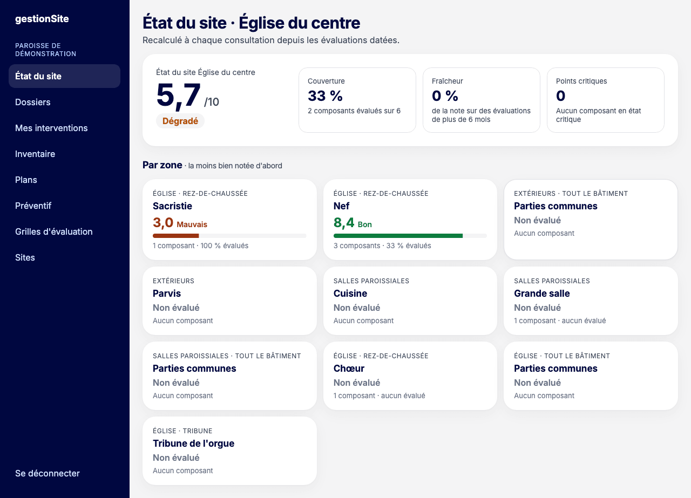
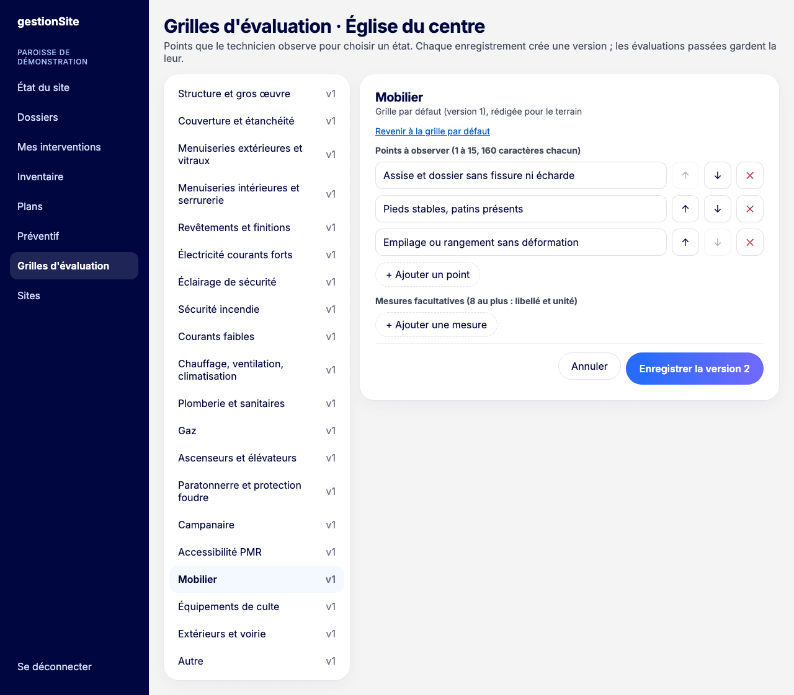

# 7. Évaluations et état du site {#evaluations}

Une **évaluation** note l'état d'un composant à une date donnée. Les évaluations donnent la **note du site** sur 10.

## L'échelle commune {#evaluations-echelle}

Chaque composant reçoit un état parmi cinq. Chaque état vaut une note :

| État | Note |
| --- | --- |
| Bon | 9 |
| Satisfaisant | 7 |
| Dégradé | 5 |
| Mauvais | 3 |
| Critique | 1 |

La **grille** du corps d'état liste les points à observer. Ces points guident votre choix : la note n'est pas calculée automatiquement à partir d'eux.

## Évaluer un composant {#evaluations-evaluer}

**Pour qui :** technicien, responsable, délégué du site.

**Où cliquer :** menu **Inventaire**, fiche du composant, **Évaluer**. L'écran est pensé pour le téléphone.

L'évaluation se fait en trois étapes.

1. **Points à observer** : pour chaque point de la grille, choisissez **Conforme**, **Défaut** ou **Non vérifié**. Renseignez les mesures utiles si vous les avez (température, humidité…). Cliquez sur **Suivant : état**.

   

2. **État** : choisissez l'état constaté. Cliquez sur **Suivant : photos et remarque**.

   

3. **Photos et remarque** : ajoutez des photos (obligatoires pour **Mauvais** et **Critique**, 3 au plus) et une remarque. Cliquez sur **Enregistrer l'évaluation**.

   

**Retour** revient à l'étape précédente sans perdre la saisie.

**Ce que vous voyez ensuite :** la fiche du composant affiche « Évaluation enregistrée » avec la note, les points observés, les mesures, les photos et l'historique des évaluations.

**État critique :** après une évaluation « Critique », l'application propose **Ouvrir un dossier prérempli**. Le dossier n'est pas créé automatiquement : vous relisez la déclaration (zone, composant, constat), puis vous cliquez sur **Déclarer**.

## Évaluer un lot {#evaluations-lot}

Pour un lot, l'étape 2 demande **Combien dans chaque état ?** Répartissez la quantité totale entre les cinq états.

La note du lot est la moyenne des états, pondérée par les quantités. La répartition de l'inventaire devient celle de cette évaluation.

## Lire l'état du site {#evaluations-etat-site}

**Pour qui :** équipe du site.

**Où cliquer :** menu **État du site**.

En tête, la **note du site** sur 10 et son libellé, puis trois indicateurs :

- **Couverture** : la part des composants actifs qui ont au moins une évaluation ;
- **Fraîcheur** : la part de la note qui repose sur des évaluations de plus de 6 mois (elles comptent toujours, mais méritent d'être refaites) ;
- **Points critiques** : les composants en état critique, avec un lien vers chacun.

Dessous, une carte par zone, **la moins bien notée d'abord**. Cliquez sur une zone pour ouvrir son inventaire.

**Comment la note est calculée**

- La note d'une zone est la moyenne des composants évalués de la zone.
- La note du site est la moyenne des zones évaluées. La zone **Parties communes** compte comme une zone.
- Un composant sans évaluation ne change pas la note, mais baisse la couverture.
- Un composant retiré sort du calcul.
- La note s'affiche avec une décimale. Le libellé suit la note affichée : moins de 2 « Critique », moins de 4 « Mauvais », moins de 6 « Dégradé », moins de 8 « Satisfaisant », 8 et plus « Bon ».
- Sans aucune évaluation, le site est « Non évalué » : aucune note n'est inventée.

Une bonne note ne fait pas disparaître un danger : consultez toujours les dossiers.

## Adapter une grille d'évaluation {#evaluations-grilles}

**Pour qui :** responsable, délégué.

**Où cliquer :** menu **Grilles d'évaluation**.

Il existe une grille par corps d'état, proposée par défaut. Vous pouvez l'adapter pour votre site.

1. Choisissez le corps d'état dans la liste de gauche.
2. Modifiez les **Points à observer** (1 à 15, 160 caractères chacun) : **+ Ajouter un point**, flèches ↑ et ↓ pour l'ordre, ✕ pour supprimer.
3. Modifiez les **Mesures facultatives** (8 au plus, avec leur unité).
4. Cliquez sur **Enregistrer la version …**.

**À savoir**

- Chaque enregistrement crée une nouvelle version. Les évaluations passées gardent la version qu'elles ont utilisée.
- **Revenir à la grille par défaut** recharge la grille d'origine dans le formulaire ; elle devient une nouvelle version quand vous l'enregistrez.
- Une grille adaptée porte la mention « adaptée » dans la liste.
