# 8. Préventif {#preventif}

Le préventif organise l'entretien régulier et les vérifications périodiques : inspection d'un tableau électrique, vérification des extincteurs, nettoyage des chéneaux avant l'hiver.

- Un **plan préventif** dit quoi faire, sur quoi, à quelle fréquence, et qui intervient habituellement.
- Chaque plan produit des **échéances** : la date à laquelle le prochain contrôle est attendu.
- Un **contrôle** enregistre ce qui a été fait à une échéance.

L'application propose des périodicités et des références réglementaires **à confirmer** par un bureau de contrôle ou le SDIS. Elle n'affiche jamais « conforme » : elle ne remplace pas la responsabilité de l'exploitant.

**Pour qui :** toute l'équipe du site consulte le préventif, contrôles et rapports compris. Le responsable et le délégué le planifient. Le technicien fait les contrôles qui lui sont affectés.

## Déclarer le classement ERP {#preventif-classement}

**Pour qui :** responsable, délégué.

**Où cliquer :** menu **Préventif**, **Voir les plans proposés**, puis l'onglet du bâtiment.

Le classement d'un bâtiment ajuste les plans proposés. L'application ne calcule ni l'effectif ni la catégorie : vous les déclarez.

1. Cochez **Établissement recevant du public (ERP)** si c'est le cas.
2. Choisissez le **Type principal** (V pour un lieu de culte) et la **Catégorie déclarée** (1 à 5).
3. Renseignez si besoin l'**Effectif déclaré** et la **Dernière visite de la commission**.
4. Cochez **Locaux à sommeil** ou **Classé ou inscrit Monuments historiques** si c'est le cas.
5. Indiquez si le **Permis de construire** date d'avant le 1er juillet 1997 (oui, non, inconnu).
6. Cliquez sur **Enregistrer le classement**.

Dans la partie **Site**, cochez **Salariés présents sur le site** si des salariés y travaillent (obligations du Code du travail), puis **Enregistrer**.

## Confirmer ou écarter les plans proposés {#preventif-propositions}

**Pour qui :** responsable, délégué.

**Où cliquer :** menu **Préventif**, **Voir les plans proposés**.

L'application propose des plans d'après le classement des bâtiments et les composants **soumis à vérification** de l'inventaire. Chaque proposition indique la nature (inspection, entretien, vérification extérieure), la fréquence, l'intervenant habituel, le fondement (réglementaire ou bonne pratique), la cible et la première échéance. **Référence** déplie le texte d'origine.

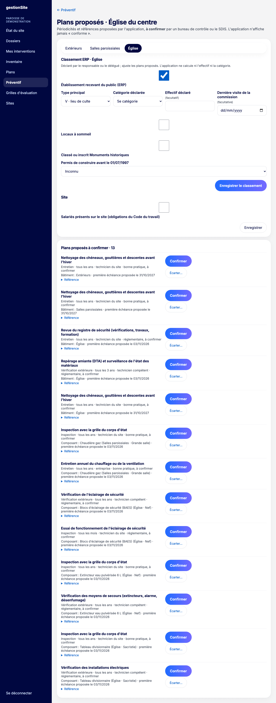

- **Confirmer** : le plan est créé et apparaît au calendrier.
- **Écarter…** : choisissez un motif (non concerné ; suivi ailleurs, par exemple un contrat ou un registre papier ; autre avec commentaire), puis **Écarter la proposition**. Une proposition écartée reste visible avec son motif et peut être confirmée plus tard (**Revoir et confirmer**).

Les autres membres voient les propositions sans pouvoir agir.

## Lire le calendrier {#preventif-calendrier}

**Pour qui :** équipe du site.

**Où cliquer :** menu **Préventif**.

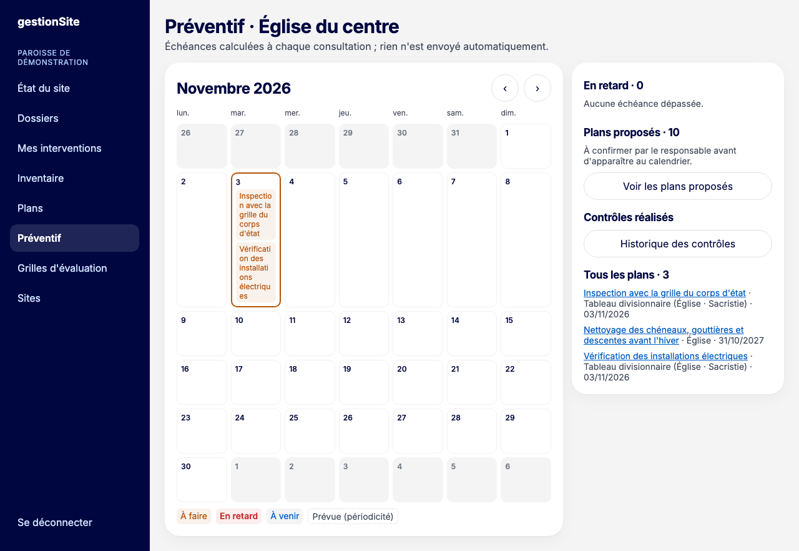

Le calendrier mensuel montre les échéances, avec leur état écrit :

- **À venir** : l'échéance est lointaine ;
- **À faire** : la fenêtre de réalisation est ouverte (environ 10 % de la période avant l'échéance, entre 7 et 30 jours) ;
- **En retard** : l'échéance est passée. Il n'y a aucune tolérance ;
- **Prévue (périodicité)** : une échéance future calculée d'après la fréquence.

Les flèches ‹ et › changent de mois. Le panneau de droite liste les échéances **En retard**, **Mes contrôles** (les vôtres), le nombre de **Plans proposés**, l'**Historique des contrôles** et **Tous les plans**.

Les échéances sont recalculées à chaque consultation. Rien n'est envoyé automatiquement.

## Affecter une échéance {#preventif-affecter}

**Pour qui :** responsable, délégué.

**Où cliquer :** cliquez sur le plan (dans le calendrier ou la liste), panneau **Affecter l'échéance**.

1. Choisissez un **Technicien du site**, ou saisissez un **prestataire** (raison sociale) et son **Référent interne**.
2. Cliquez sur **Affecter**.

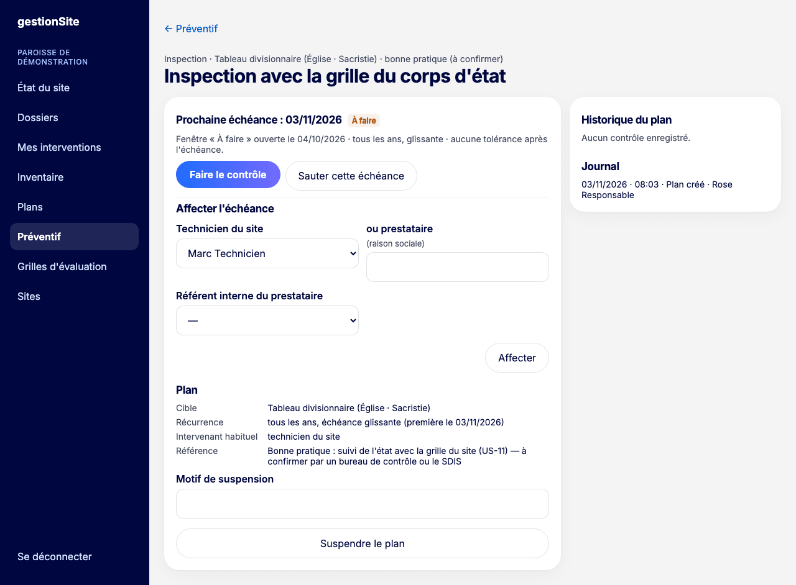

La fiche du plan indique « Affectée à … ». L'échéance apparaît dans **Mes contrôles** de la personne.

**Sur la même fiche :**

- **Sauter cette échéance** (personne en charge, responsable, délégué) : choisissez le motif (installation hors service ou déposée, inaccessible, autre avec commentaire), puis **Sauter l'échéance**. L'échéance suivante est calculée.
- **Suspendre le plan** (responsable, délégué) : saisissez un motif, puis **Suspendre le plan** ; **Reprendre le plan** le relance. Un plan est aussi suspendu de lui-même quand son composant est retiré ou n'est plus soumis à vérification.
- **Historique du plan** et **Journal** : contrôles réalisés, échéances sautées, modifications.

## Faire un contrôle sur téléphone {#preventif-controler}

**Pour qui :** la personne affectée (technicien ou référent du prestataire), ou un responsable ou délégué.

**Où cliquer :** menu **Préventif**, **Mes contrôles**, **Contrôler** ; ou, sur la fiche du plan, **Faire le contrôle**.

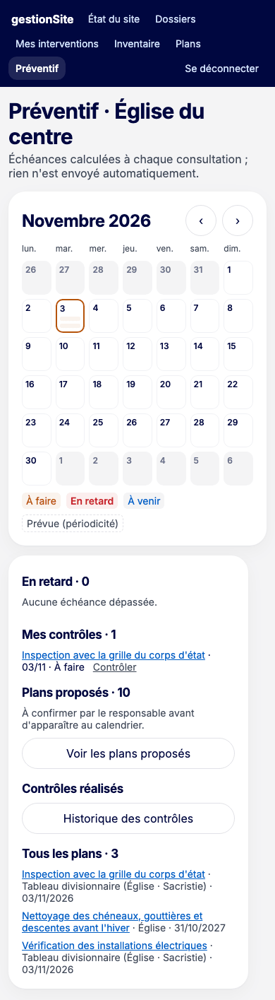

Le contrôle se fait pas à pas, comme une évaluation. Les étapes dépendent de la nature du plan.

**Inspection d'un composant** (3 étapes) :

1. **Points à observer** : pour chaque point, choisissez **Sans défaut**, **Défaut**, **Défaut, danger** ou **Non vérifié**. Saisissez les mesures utiles.

   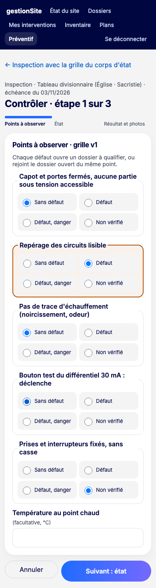

2. **État** : l'état du composant, comme pour une [évaluation](07-evaluations.md#evaluations-evaluer). L'évaluation est enregistrée en même temps que le contrôle et met la note à jour.
3. **Résultat et photos** : vérifiez la **Date de réalisation**, choisissez le **Résultat déclaré**, ajoutez photos et remarque, puis **Enregistrer le contrôle**.

   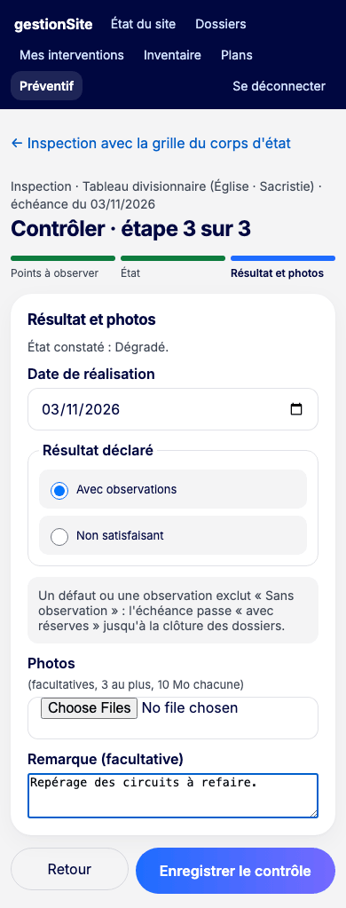

**Inspection d'une zone** : 2 étapes (points à observer, puis résultat et photos).

**Entretien** : 2 étapes (**Relevés**, puis **Résultat et compte rendu**). Le compte rendu est obligatoire.

**Résultats possibles :** **Sans observation**, **Avec observations**, **Non satisfaisant**. Dès qu'un point est en défaut, « Sans observation » n'est plus proposé : l'échéance passe « avec réserves ».

**Ce que vous voyez ensuite :** la fiche du contrôle, avec un message qui résume l'évaluation et les dossiers ouverts.

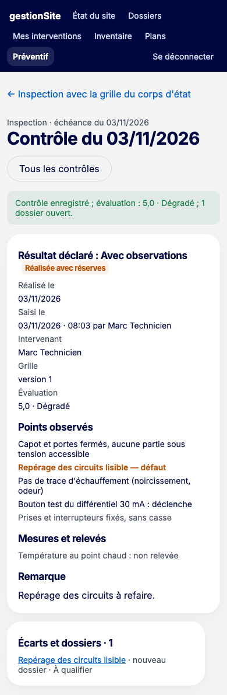

## Saisir une vérification extérieure et son rapport PDF {#preventif-verification}

**Pour qui :** responsable, délégué, ou le référent interne du prestataire.

Une vérification extérieure est faite par un organisme ou une entreprise (bureau de contrôle, installateur). Vous saisissez son rapport.

1. Sur la fiche du plan, cliquez sur **Faire le contrôle**.
2. Étape **Intervenant et observations** :
   - **Prestataire** : la raison sociale (laissez vide si c'est l'intervenant affecté) et le **N° d'agrément** s'il existe ;
   - **Observations du rapport** : une ligne par observation, avec sa **Zone** et la case **Danger signalé** si besoin ; **+ Ajouter une observation** pour la suivante (50 au plus) ;
   - **Relevés** facultatifs (libellé, valeur, unité).

   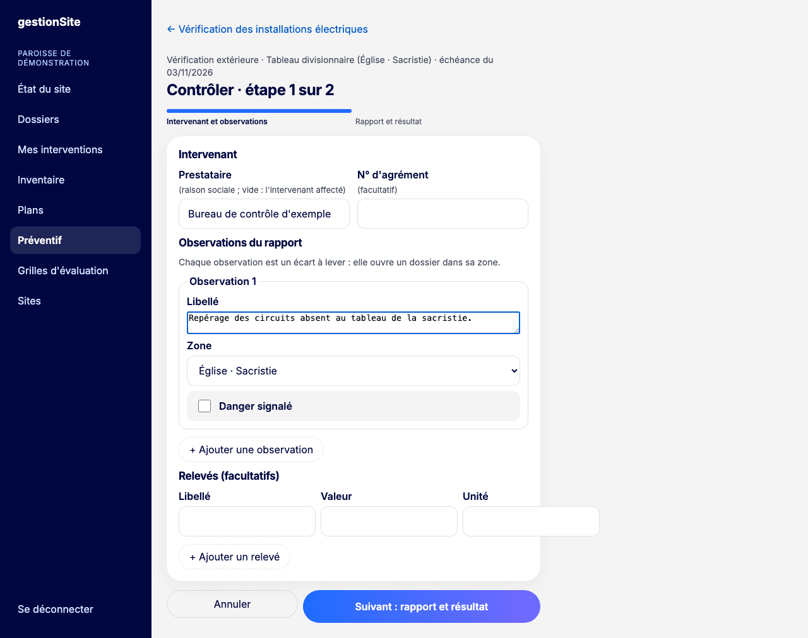

3. Étape **Rapport et résultat** : **Date de réalisation**, **Résultat déclaré**, **Rapport PDF**, photos et compte rendu. Cliquez sur **Enregistrer le contrôle**.

   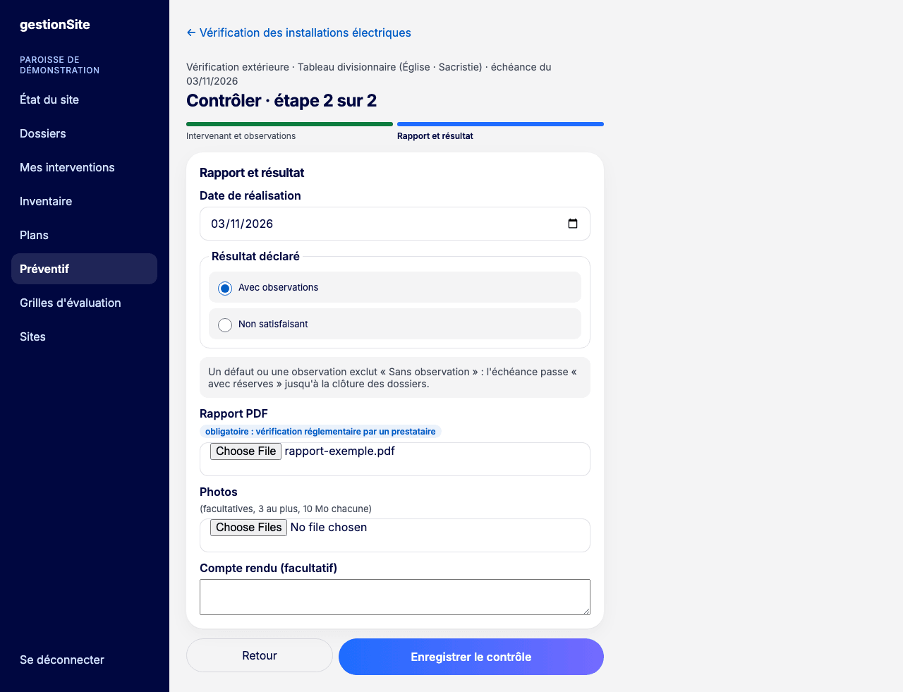

**À savoir**

- Le rapport PDF est **obligatoire** pour une vérification réglementaire faite par un prestataire. Il est facultatif sinon. Taille : 10 Mo au plus.
- Le rapport est conservé et se télécharge depuis la fiche du contrôle (**Télécharger le rapport PDF**), avec son empreinte qui garantit qu'il n'a pas été modifié.
- Chaque observation est un écart à lever : elle ouvre un dossier dans sa zone.

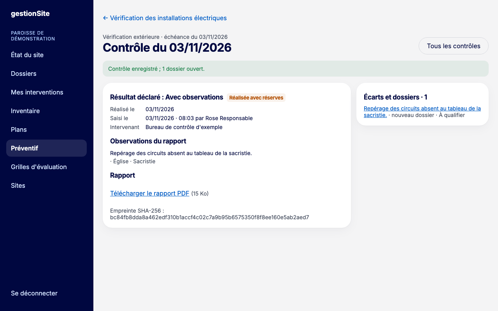

## Suivre les non-conformités {#preventif-non-conformites}

Chaque point en **Défaut** et chaque observation d'un rapport crée un dossier **À qualifier** dans [Dossiers](05-dossiers.md#dossiers), à traiter comme les autres. Un défaut avec danger crée un dossier marqué **Danger**.

- Si un dossier est déjà ouvert pour le même composant (ou la même zone) et le même point, le nouveau constat y est **rattaché** au lieu d'ouvrir un second dossier. L'historique du dossier l'indique (« Constat d'inspection rattaché »).
- Le panneau **Écarts et dossiers** de la fiche du contrôle liste les dossiers liés et leur statut.
- Quand tous les dossiers liés sont clos, la fiche affiche **Réserves levées**.

## Consulter l'historique des contrôles {#preventif-historique}

**Où cliquer :** menu **Préventif**, **Historique des contrôles**.

La liste montre les contrôles du site, le plus récent d'abord : date, plan, nature, résultat, nombre d'écarts, note et présence d'un rapport PDF. Les résultats sont déclarés par l'intervenant : ce ne sont jamais des attestations de conformité.

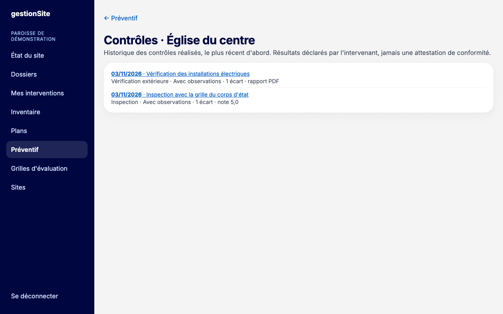

> **Pas encore disponible.** Aucun rappel n'est envoyé avant une échéance ou en cas de retard. Consultez le calendrier régulièrement.
