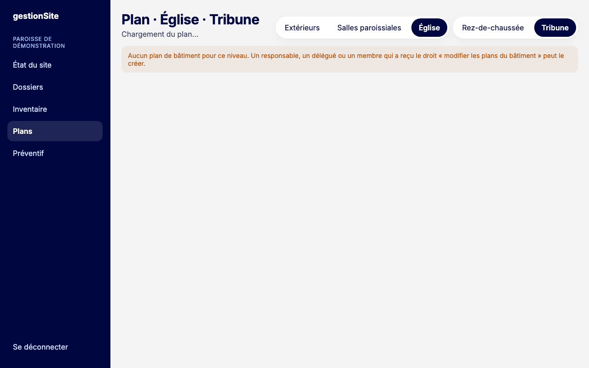
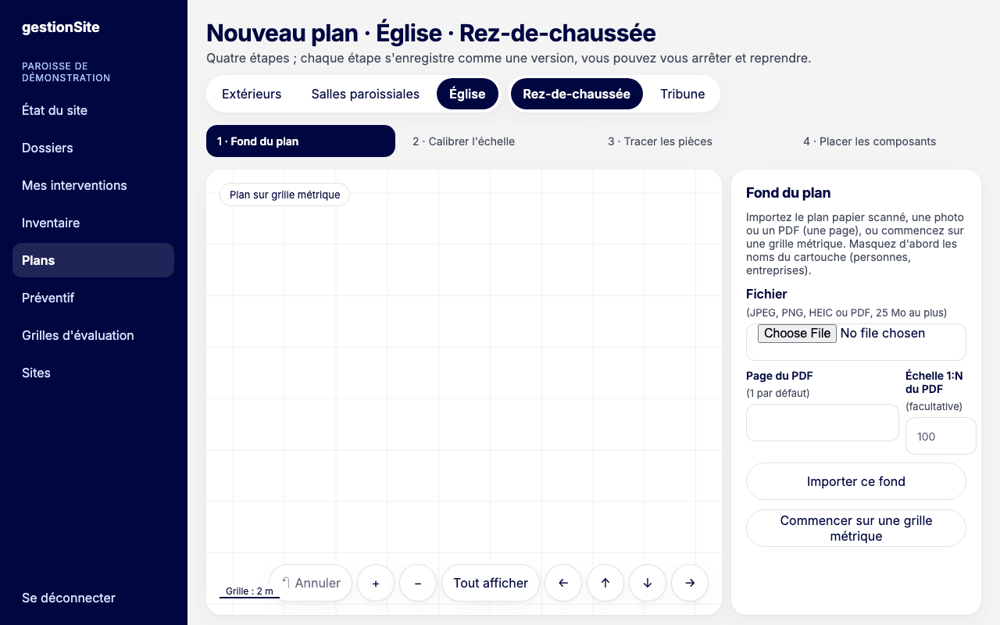
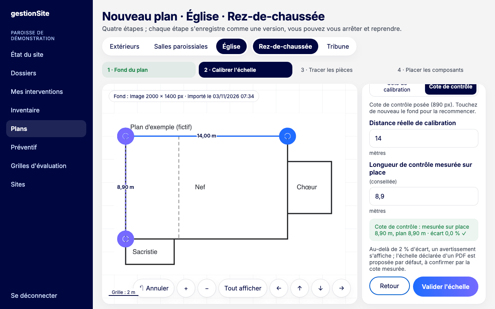
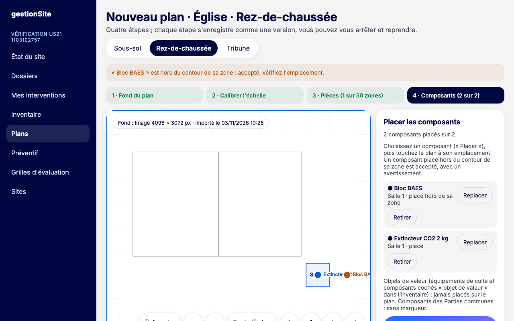
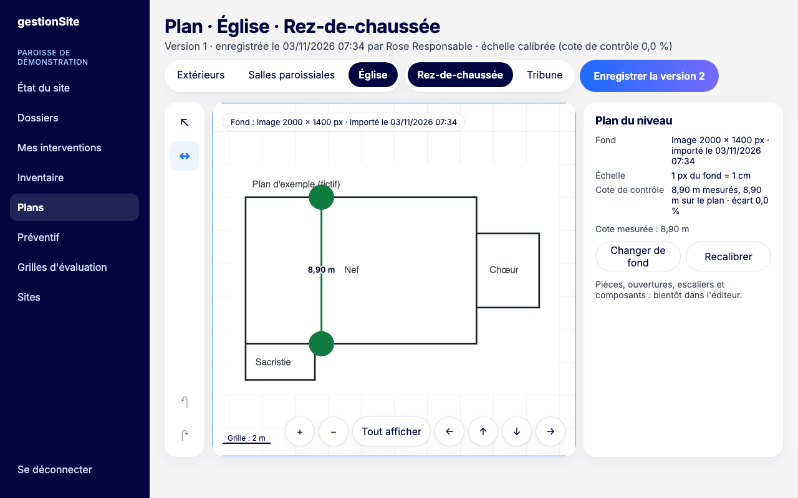
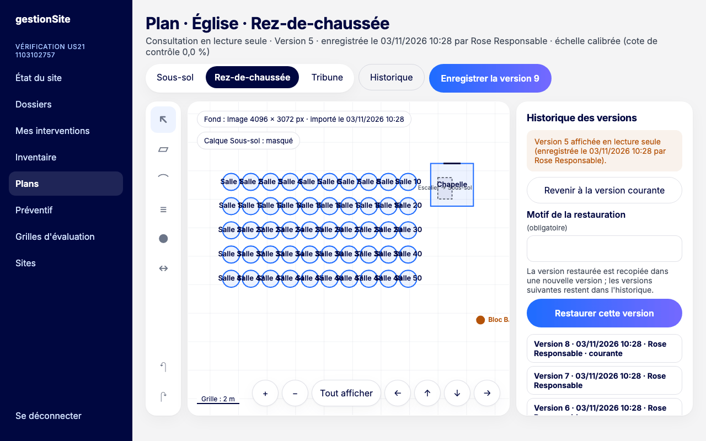
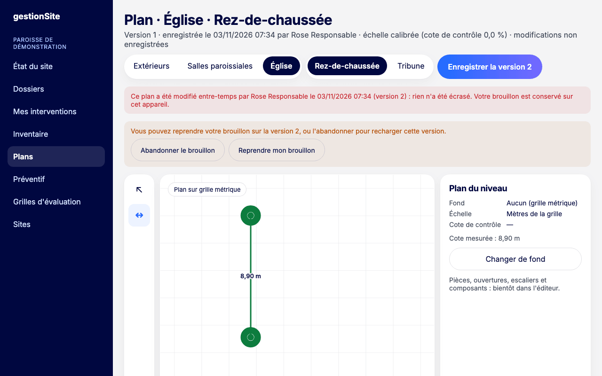

# 9. Plans de bâtiment {#plans}

Le **plan de bâtiment** est le dessin d'un niveau (ou du plan masse pour un bâtiment sans niveau). On part d'un plan papier scanné, d'une photo, d'un PDF, ou d'une grille vierge en mètres.

Ne confondez pas avec les **plans préventifs** du chapitre [Préventif](08-preventif.md#preventif).

**Pour qui :** tous les membres du site consultent les plans. Le responsable et le délégué les modifient, ainsi que les membres à qui l'administrateur a accordé le droit « modifier les plans du bâtiment ».

**Où cliquer :** menu **Plans**, puis les onglets du site, du bâtiment et du niveau.

Les plans se dessinent de préférence sur ordinateur ou tablette.

> **Pas encore disponible.** Le droit nominatif « modifier les plans du bâtiment » s'accordera dans **Membres** (écran en préparation) : en attendant, demandez-le à l'équipe du projet. Déclarer un problème depuis une pièce du plan arrive dans une prochaine version.

## Créer un plan : le parcours guidé {#plans-parcours}

Quand un niveau n'a pas encore de plan, l'écran **Nouveau plan** ouvre un parcours en quatre étapes : **Fond du plan**, **Calibrer l'échelle**, **Tracer les pièces**, **Placer les composants**. Chaque étape validée est enregistrée comme une version : vous pouvez vous arrêter et reprendre plus tard.

Un membre qui ne peut pas modifier les plans voit le message « Aucun plan de bâtiment pour ce niveau ».

## Importer le fond du plan {#plans-fond}

**Pour qui :** responsable, délégué, ou titulaire du droit sur les plans.

1. Préparez le fichier : un plan scanné, une photo ou un PDF. **Masquez d'abord les noms du cartouche** (personnes, entreprises).
2. Dans **Fichier**, choisissez le document : JPEG, PNG, HEIC ou PDF, 25 Mo au plus.
3. Pour un PDF, indiquez la **Page du PDF** (1 par défaut) et, si vous la connaissez, l'**Échelle 1:N du PDF** (par exemple 100 pour 1:100).
4. Cliquez sur **Importer ce fond**. Un PDF peut demander jusqu'à une minute.

Sans document, cliquez sur **Commencer sur une grille métrique** : le plan se dessinera sur une grille en mètres.

Si un fond a déjà été importé pour ce plan, il est proposé dans **Fonds déjà importés**.

**Erreurs fréquentes**

- « Fichier trop volumineux : 25 Mo au plus. »
- PDF protégé : enregistrez-le sans protection, puis importez-le de nouveau.
- Page absente : le message indique le nombre de pages du PDF.
- Quota atteint : l'organisation dispose d'un espace limité pour ses fonds de plan. Contactez l'équipe du projet.

## Calibrer l'échelle {#plans-calibrer}

La calibration indique à l'application combien mesure une longueur du fond. Elle est obligatoire pour un fond importé.

1. Touchez (ou cliquez) les deux extrémités d'une **longueur connue** sur le fond, idéalement plus de 10 mètres (la longueur de la nef). Zoomez pour pointer avec précision.
2. Saisissez la **Distance réelle de calibration** en mètres (par exemple 14,33).
3. Conseillé : choisissez **Cote de contrôle**, touchez les extrémités d'une autre longueur mesurée sur place, puis saisissez la **Longueur de contrôle mesurée sur place**. L'application affiche l'écart en pourcentage.
4. Cliquez sur **Valider l'échelle**. Le plan est enregistré en version 1 et l'étape **Tracer les pièces** commence.

**À savoir**

- Au-delà de 2 % d'écart sur la cote de contrôle, un avertissement s'affiche : vérifiez vos points et vos mesures. Ce n'est pas un blocage.
- Pour un PDF à échelle déclarée, la distance est proposée d'après l'échelle ; confirmez-la par une cote mesurée.
- **Annuler** retire la dernière saisie. **Retour** revient au choix du fond.

**Erreurs fréquentes**

- « Touchez à l'intérieur du fond. »
- « Distance : saisissez un nombre de mètres, par exemple 14,33. »

## Tracer les pièces {#plans-pieces}

À l'étape 3 du parcours guidé, les zones du niveau (celles de l'[inventaire](06-inventaire.md#inventaire)) sont proposées une à une : « → » la zone en cours, « ✓ » celles déjà tracées.

1. Touchez les angles de la pièce un à un, sur les faces intérieures des murs. Les points s'accrochent aux angles et aux murs voisins.
2. Touchez de nouveau le premier angle, ou cliquez sur **Fermer la pièce**. La zone suivante est proposée.
3. **Zone suivante** passe une zone sans la tracer.
4. Cliquez sur **Terminer les pièces** : la version est enregistrée et l'étape **Placer les composants** commence.

Les **Parties communes** et les zones sans niveau ne se tracent pas : elles sont listées à côté du plan. Dans l'atelier, les outils **Pièce**, **Porte, baie ou fenêtre** et **Escalier** servent à compléter ou corriger le dessin.

## Placer les composants {#plans-composants}

**Pour qui :** responsable, délégué, ou titulaire du droit sur les plans.

**Où cliquer :** étape 4 du parcours guidé, ou outil **Composant** (rond plein) de l'atelier, ou **Placer** dans la liste **Composants de la zone** d'une pièce sélectionnée.

1. Dans la liste, cliquez sur **Placer** à côté du composant.
2. Touchez le plan à son emplacement. Le composant apparaît sous forme de pastille avec son nom.
3. Pour le déplacer, cliquez sur **Replacer** puis touchez le nouvel emplacement, ou sélectionnez la pastille et glissez-la.
4. Dans le parcours guidé, cliquez sur **Terminer le plan** : la version est enregistrée et l'atelier s'ouvre. Dans l'atelier, cliquez sur **Enregistrer la version …**.

**Pastille sélectionnée :** le panneau montre sa zone et ses coordonnées. Saisissez **X (m)** et **Y (m)**, ou utilisez les flèches (10 cm par appui), pour la placer sans glisser. **Retirer du plan** enlève la pastille ; le composant reste dans l'inventaire.

**À savoir**

- Seuls les composants des zones de ce niveau sont proposés. Les composants des Parties communes d'un bâtiment à niveaux restent sans pastille.
- Les **objets de valeur** ne sont jamais proposés : équipements de culte et composants cochés **Objet de valeur** dans l'[inventaire](06-inventaire.md#inventaire-objet-valeur). Le panneau d'une pièce indique combien elle en contient.
- Un composant placé hors du contour de sa zone est accepté, avec une pastille orange et un avertissement : vérifiez l'emplacement.
- Un composant retiré de l'inventaire, déplacé dans une autre zone ou devenu objet de valeur n'est plus affiché. L'éditeur le signale (« 1 marqueur de composant n'est plus affiché… ») ; il disparaît de la prochaine version enregistrée.

**Erreurs fréquentes**

- « Choisissez d'abord un composant dans la liste (« Placer »). »
- « « … » est hors du contour de sa zone : accepté, vérifiez l'emplacement. »

## Travailler dans l'atelier {#plans-atelier}

Dès qu'un niveau a un plan, l'**atelier** s'ouvre : outils à gauche, plan au centre, propriétés à droite. En haut, le résumé de la version (numéro, date, auteur, échelle).

**Se déplacer dans le plan**

- À la souris ou au doigt : glissez pour déplacer la vue ; molette ou deux doigts pour zoomer.
- Avec les boutons : **+**, **−**, **Tout afficher** et les flèches.
- Au clavier, le plan sélectionné : flèches, **+**, **−**, **0** (tout afficher).

**Outils**

- **Sélection** (flèche) : déplacer la vue ; toucher une pièce, une ouverture, un escalier ou une pastille de composant pour le modifier.
- **Pièce**, **Porte, baie ou fenêtre**, **Escalier**, **Composant** : voir [Tracer les pièces](#plans-pieces) et [Placer les composants](#plans-composants).
- **Cote** (double flèche) : touchez deux points pour mesurer une longueur. La mesure s'affiche sur le plan et dans le panneau (« Cote mesurée »).
- **Annuler** et **Rétablir** : aussi avec Ctrl+Z et Ctrl+Y.

**Panneau de droite :** fond, échelle et cote de contrôle du plan ; **Changer de fond** et **Recalibrer** (une nouvelle calibration donne une nouvelle version).

**Calque du niveau inférieur :** quand le niveau du dessous a un plan, le bouton **Calque … : masqué** l'affiche en pointillés sous le plan courant.

**Enregistrer :** le bouton **Enregistrer la version …** crée une nouvelle version. Chaque version est conservée.

Un membre qui consulte seulement voit le plan, les pastilles des composants, le zoom, le calque et l'historique, sans commande de modification.

**Qui modifie le plan :** l'administrateur voit dans le panneau de droite qui peut modifier ce plan, avec un lien vers **Membres**.

## Historique et restauration {#plans-historique}

**Pour qui :** tous les membres du site consultent l'historique ; le responsable, le délégué ou le titulaire du droit sur les plans restaurent une version.

**Où cliquer :** bouton **Historique** en haut de l'atelier.

1. La liste montre les versions, de la plus récente à la plus ancienne : numéro, date, auteur, motif. **Versions plus anciennes** affiche la suite.
2. Cliquez sur une version : elle s'affiche **en lecture seule** (le résumé commence par « Consultation en lecture seule »). **Revenir à la version courante** la referme.
3. Pour la restaurer, saisissez le **Motif de la restauration** puis cliquez sur **Restaurer cette version**.

La version restaurée est recopiée dans une **nouvelle version** : rien n'est effacé, les versions suivantes restent dans l'historique. Les pastilles des composants retirés depuis, passés sur un autre niveau ou devenus objets de valeur ne sont pas recopiées : le message indique combien ont été retirées.

**Erreurs fréquentes**

- « Motif obligatoire : indiquez pourquoi vous restaurez cette version. »
- « Enregistrez ou abandonnez d'abord vos modifications en cours. »
- « Ce plan a été modifié entre-temps par … (version …) : rien n'a été restauré. Rechargez la page, puis recommencez. »

## Brouillon et conflit {#plans-brouillon}

**Le brouillon.** Tant que vous n'avez pas enregistré, vos modifications sont gardées sur l'appareil, pour votre compte. Si la page se ferme, elles sont reprises à la prochaine ouverture (« Brouillon non enregistré repris »). **Abandonner le brouillon** les efface. La déconnexion efface aussi tous les brouillons de l'appareil.

**Le conflit.** Si quelqu'un d'autre a enregistré le même plan pendant que vous travailliez, votre enregistrement est refusé. Rien n'est écrasé : le message nomme l'autre auteur et sa version.

Deux choix :

- **Abandonner le brouillon** : vous rechargez la version de l'autre personne ;
- **Reprendre mon brouillon**, puis **Confirmer** : votre brouillon deviendra la prochaine version. Celle de l'autre personne reste dans l'historique.

Enregistrez ensuite avec **Enregistrer la version …**.

**Erreurs fréquentes**

- « Votre session a expiré : reconnectez-vous. Votre brouillon est conservé sur cet appareil. »
- « Ce niveau a déjà un plan, créé entre-temps : rechargez la page. »
