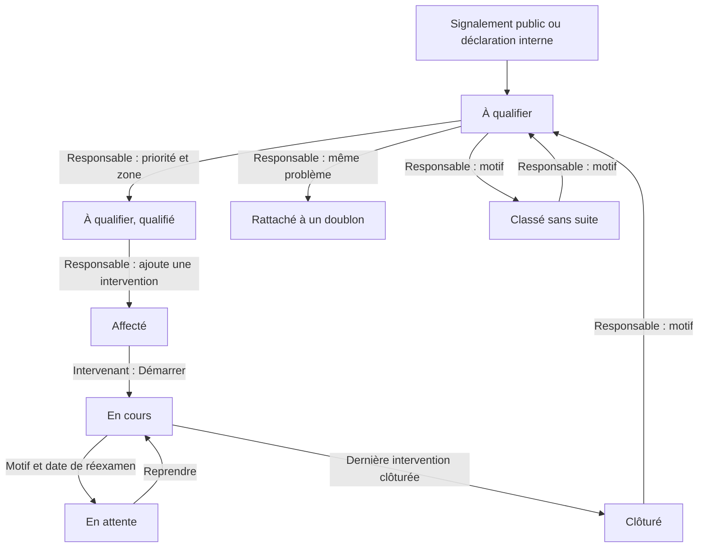
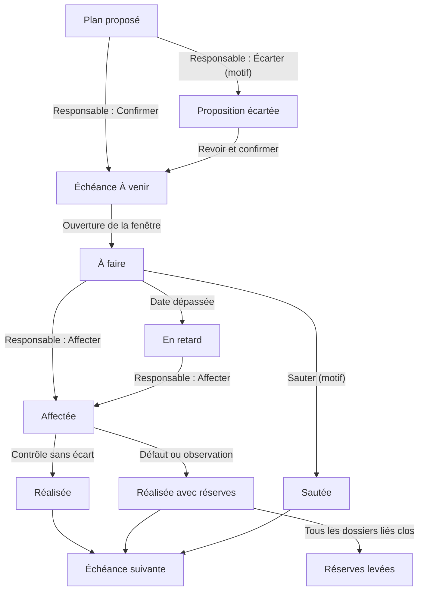
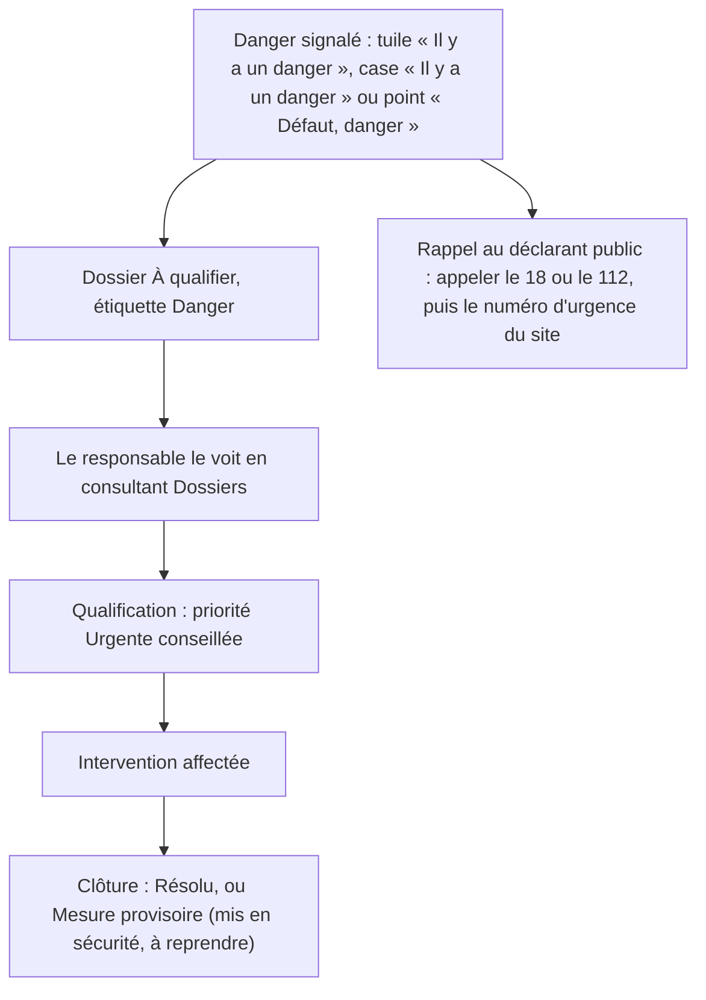

# 10. Workflows {#workflows}

Ce chapitre résume les grands cycles de l'application, tels qu'ils fonctionnent aujourd'hui.

## Le cycle d'un dossier {#workflows-dossier}

| Étape | Qui agit | Ce qui se passe |
| --- | --- | --- |
| Déclaration | Public ou membre du site | Le dossier arrive **À qualifier**. |
| Qualification | Responsable, délégué | Priorité, zone, composant éventuel. |
| Doublon ou classement | Responsable, délégué | Le dossier part aux archives. |
| Affectation | Responsable, délégué | Une intervention est confiée à un technicien ou à un prestataire suivi par un référent. Le délai de prise en charge court. |
| Démarrage | Intervenant, référent, responsable | Le dossier passe **En cours** ; le délai de résolution court. |
| Attente | Intervenant, référent, responsable | Motif et date de réexamen ; le délai de résolution est suspendu. |
| Clôture | Intervenant, référent, responsable | Actions, état final, photo si exigée. La dernière intervention clôturée clôture le dossier. |
| Réouverture | Responsable, délégué | Avec un motif ; retour **À qualifier**. |

Détails : chapitre [Dossiers](05-dossiers.md#dossiers).

## Le cycle d'une échéance préventive {#workflows-echeance}

- Une échéance peut aussi être contrôlée sans affectation préalable par un responsable ou un délégué.
- En mode **glissant** (par défaut), l'échéance suivante part de la date réelle du contrôle. En mode **fixe**, elle garde le calendrier prévu (par exemple, fin octobre pour les chéneaux).
- Un plan suspendu ne produit plus d'échéance jusqu'à sa reprise.

Détails : chapitre [Préventif](08-preventif.md#preventif).

## Le danger, tel qu'il existe aujourd'hui {#workflows-danger}

**Ce qu'il faut retenir**

- L'application **n'alerte personne** aujourd'hui : le danger est visible seulement dans l'écran **Dossiers** (carte rouge, étiquette **Danger**) et sur la fiche (**Danger signalé**).
- Le premier réflexe reste l'appel des secours (18 ou 112), puis le numéro d'urgence du site et les consignes affichées dans le bâtiment.
- La priorité est choisie par le responsable ; elle ne découle pas automatiquement du danger.
- Une mise en sécurité se note à la clôture d'une intervention avec l'état final **Mesure provisoire** ; le dossier peut ensuite être rouvert pour la réparation définitive.

> **Pas encore disponible.** Une prochaine version ajoutera le suivi du danger : alerte dans un centre de notifications, prise en compte par un responsable, déclaration et vérification de la mise en sécurité, rappels tant que rien n'est fait.
