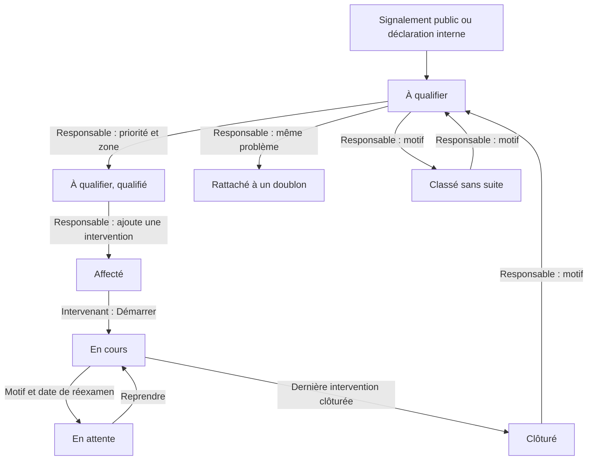
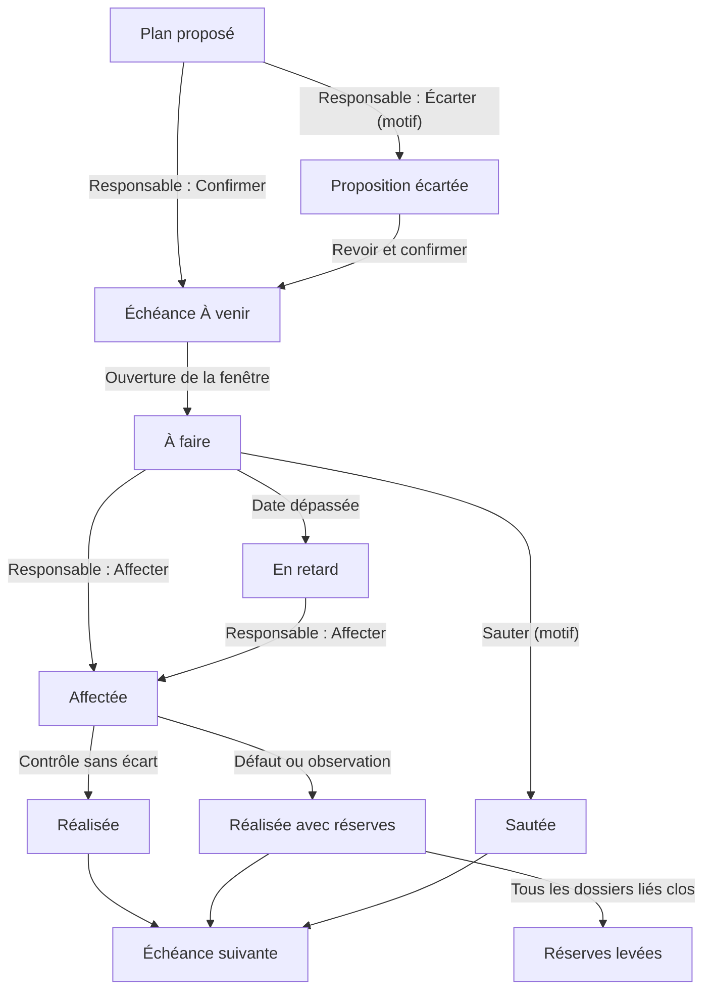
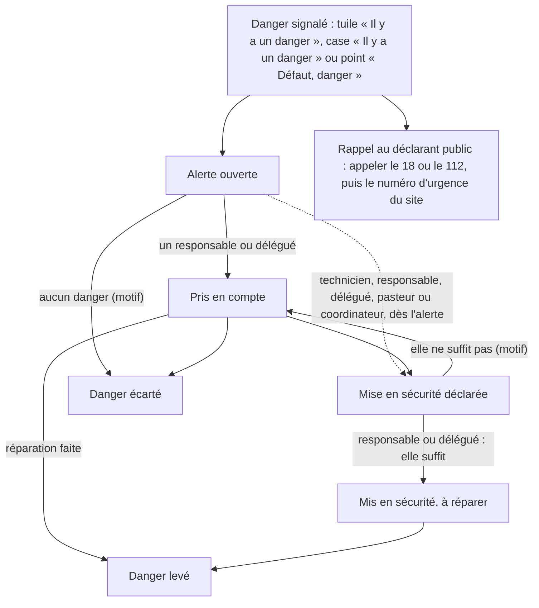

# 10. Workflows {#workflows}

Ce chapitre résume les grands cycles de l'application, tels qu'ils fonctionnent aujourd'hui.

## Le cycle d'un dossier {#workflows-dossier}

| Étape | Qui agit | Ce qui se passe |
| --- | --- | --- |
| Déclaration | Public ou membre du site | Le dossier arrive **À qualifier**. |
| Qualification | Responsable, délégué | Priorité, zone, composant éventuel. |
| Doublon ou classement | Responsable, délégué | Le dossier part aux archives. |
| Affectation | Responsable, délégué | Une intervention est confiée à un technicien ou à un prestataire suivi par un référent. Le délai de prise en charge court. |
| Démarrage | Intervenant, référent, responsable | Le dossier passe **En cours** ; le délai de résolution court. |
| Attente | Intervenant, référent, responsable | Motif et date de réexamen ; le délai de résolution est suspendu. |
| Clôture | Intervenant, référent, responsable | Actions, état final, photo si exigée. La dernière intervention clôturée clôture le dossier. |
| Réouverture | Responsable, délégué | Avec un motif ; retour **À qualifier**. |

Détails : chapitre [Dossiers](05-dossiers.md#dossiers).

## Le cycle d'une échéance préventive {#workflows-echeance}

- Une échéance peut aussi être contrôlée sans affectation préalable par un responsable ou un délégué.
- En mode **glissant** (par défaut), l'échéance suivante part de la date réelle du contrôle. En mode **fixe**, elle garde le calendrier prévu (par exemple, fin octobre pour les chéneaux).
- Un plan suspendu ne produit plus d'échéance jusqu'à sa reprise.

Détails : chapitre [Préventif](08-preventif.md#preventif).

## Le danger et sa mise en sécurité {#workflows-danger}

Un danger se suit à part du dossier : la réparation suit le cycle du dossier, la mise en sécurité suit le cycle ci-dessous. La clôture du dossier ne lève pas le danger. Ces règles sont en place dans l'application ; les écrans qui permettent d'agir arrivent avec la prochaine version (voir l'encadré en fin de section).

**Ce qu'il faut retenir**

- Le premier réflexe reste l'appel des secours (18 ou 112), puis le numéro d'urgence du site et les consignes affichées dans le bâtiment. L'application n'est pas une alarme.
- **Prise en compte** : un responsable ou un délégué indique qu'il suit le danger. Sans prise en compte 15 minutes après l'alerte, une nouvelle alerte part à tous ses destinataires (responsable, délégués, pasteurs, coordinateurs, et le technicien qui a une intervention ouverte sur le dossier), puis toutes les heures, jour et nuit.
- **Mise en sécurité** : une mesure conservatoire simple, choisie dans une liste (accès condamné ou balisé, public tenu à distance, énergie coupée, évacuation, protection ou étaiement provisoire, secours appelés, autre avec commentaire). Couper l'électricité pour travailler (consignation) est réservé à une personne habilitée (norme NF C 18-510) : l'application ne le vérifie pas.
- Tant que la mise en sécurité n'est pas déclarée, celui qui a pris le danger en compte reçoit un rappel toutes les heures ; au bout de 4 heures, les autres responsables et délégués aussi.
- **Vérification** : un responsable ou un délégué confirme que la mise en sécurité suffit (le danger est maîtrisé, pas réparé), ou indique qu'elle ne suffit pas, avec un motif : le danger redevient « Pris en compte », les rappels reprennent et le déclarant est prévenu.
- **Danger levé** (réparation faite et dossier clôturé « Résolu », réparation constatée sur place, ou autre avec commentaire) ou **écarté** (aucun danger constaté, déjà traité, ou autre avec commentaire) : par un responsable ou un délégué. Chaque étape est inscrite dans l'historique du dossier, avec son auteur, sa date et son motif.
- Un dossier en danger ne peut pas être mis en attente tant qu'aucune mise en sécurité n'est déclarée réalisée (« Mettez d'abord en sécurité »).
- La priorité est choisie par le responsable ; elle ne découle pas automatiquement du danger.

> **Pas encore disponible.** Les écrans de ce suivi arrivent avec la prochaine version : cloche et centre de notifications, bandeau des dangers en cours au-dessus du suivi des dossiers, bande du danger en tête de la fiche (prendre en compte, déclarer, vérifier, lever ou écarter) et consigne de danger du site à côté du numéro d'urgence. D'ici là, le danger reste visible dans l'écran **Dossiers** (carte rouge, étiquette **Danger**) et sur la fiche (**Danger signalé**) ; une mise en sécurité peut aussi se noter à la clôture d'une intervention avec l'état final **Mesure provisoire**. Personne n'est prévenu hors de l'application (ni e-mail ni SMS).
