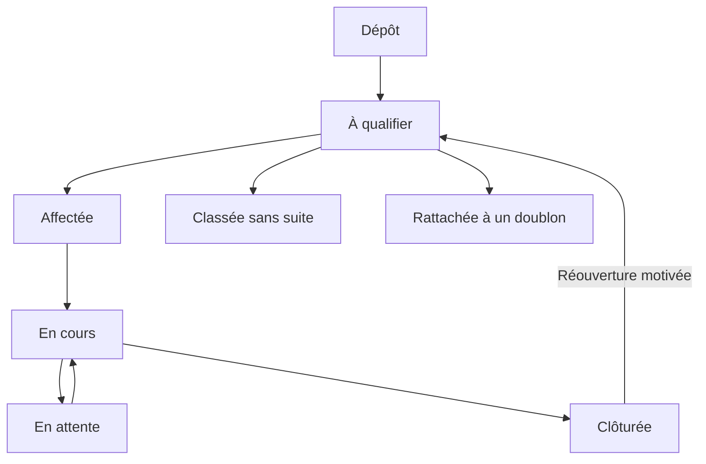

# Processus métier et machines à états
Statut : V pour les décisions DEC-03 (27 octobre 2026, porteur du projet) ; P pour le reste de la modélisation. Les invariants RG restent applicables.

## Incident et intervention

Décisions DEC-03 (V) :
- Le cycle ci-dessus est adopté tel quel (7 statuts).
- Un dossier porte 1 à N interventions, chacune avec intervenant et compte rendu. Quand la dernière intervention ouverte est clôturée, le dossier est clôturé automatiquement ; R/D sont notifiés et peuvent rouvrir avec motif.
- Doublons : à la qualification, l’application suggère les dossiers ouverts du même site et du même emplacement ; R/D confirme le rattachement. La déclaration rattachée est conservée et liée au dossier principal.
- « Classée sans suite » : R/D uniquement, réouvrable par R/D. Motif dans une liste fixe — aucun problème constaté, hors périmètre, déjà traité hors application, spam/abusif, autre — avec commentaire obligatoire pour « autre ». Ne compte pas comme réparation.
- « En attente » : technicien affecté ou R/D ; date de réexamen obligatoire. Motifs : financement/accord finance, livraison de fournitures, prestataire extérieur, accès au lieu impossible, décision interne, autre (commentaire obligatoire). Pasteurs et coordination relancent sans changer le statut.

| Transition | Acteur | Condition |
| --- | --- | --- |
| Dépôt → à qualifier | Public ou compte | Champs requis et site existant |
| Qualification → affectation | R/D | Priorité, périmètre, intervenant |
| Affectée → en cours | T affecté / R/D | Démarrage déclaré |
| En cours → attente | T affecté / R/D | Motif de la liste et date de réexamen |
| Attente → en cours | T affecté / R/D | Reprise datée |
| En cours → clôturée | T affecté / R/D | Compte rendu, état final, photo conditionnelle |
| Clôturée → à qualifier | R/D | Motif de réouverture |

La mise en sécurité est un suivi parallèle : à traiter → action réalisée → vérification. Elle ne clôture pas automatiquement la réparation et ne constitue pas une preuve de conformité.

## Demande matérielle
Reçue → qualifiée → approuvée ou refusée avec motif → autorisation de dépense si nécessaire → achat déclaré → réception → remise/installation → clôture. Un besoin couvert par le stock ne nécessite pas d’achat. Réceptions partielles (V) : chaque réception enregistre la quantité reçue ; la demande reste « partiellement reçue » avec le reliquat attendu jusqu’à réception complète ou abandon motivé du reliquat. Annulation (V) : par R/D avec motif, impossible après remise complète ; le montant réservé non dépensé est libéré, les dépenses réalisées restent enregistrées.

## Estimation et budget
Brouillon → proposée → validée techniquement → autorisée dans enveloppe OU attente finance → accord documenté → engagement → dépenses et solde libéré à achèvement.
Une validation technique ne réserve pas à elle seule le budget : l’autorisation de dépense est une action distincte, même si une interface les regroupe.
Proposition : en cas de modification d’une estimation validée, créer une révision ; ne pas modifier le PDF déjà envoyé.

## Inspection
Échéance → affectation → grille exécutée → résultats enregistrés → signalements de non-conformité → prochaine occurrence. Proposition : identifier les occurrences pour qu’une relance ne recrée pas le même contrôle.
Non-conformité déjà suivie (V) : si un dossier ouvert existe pour le même composant et le même critère de grille, le constat y est rattaché au lieu de créer un dossier ; R/D sont notifiés. Un danger déclenche toujours l’alerte.

## Transfert
Préparé → départ confirmé → en transit → réception confirmée. Proposition : transfert de consommation sans double disponibilité source/destination ; traitement de quantité manquante par écart documenté, pas par réception fictive.

