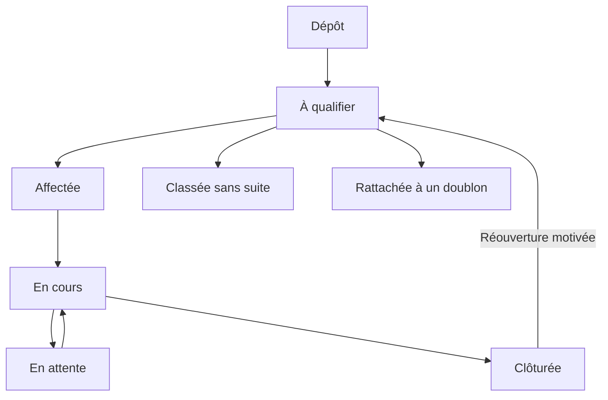

# Processus métier et machines à états
Statut : P de modélisation ; les invariants RG restent applicables.

## Incident et intervention

Signalement et intervention sont deux objets proposés : un signalement peut nécessiter plusieurs interventions. « Classé sans suite » exige un motif et ne compte pas comme réparation. Un doublon conserve sa déclaration et son lien au dossier principal. Ces extensions nécessitent validation DEC-03.

| Transition | Acteur | Condition |
| --- | --- | --- |
| Dépôt → à qualifier | Public ou compte | Champs requis et site existant |
| Qualification → affectation | R/D | Priorité, périmètre, intervenant |
| Affectée → en cours | T affecté / R/D | Démarrage déclaré |
| En cours → attente | T affecté / R/D, P | Motif et réexamen |
| Attente → en cours | T affecté / R/D | Reprise datée |
| En cours → clôturée | T affecté / R/D | Compte rendu, état final, photo conditionnelle |
| Clôturée → à qualifier | R/D | Motif de réouverture |

La mise en sécurité est un suivi parallèle : à traiter → action réalisée → vérification. Elle ne clôture pas automatiquement la réparation et ne constitue pas une preuve de conformité.

## Demande matérielle
Reçue → qualifiée → approuvée ou refusée avec motif → autorisation de dépense si nécessaire → achat déclaré → réception → remise/installation → clôture. Un besoin couvert par le stock ne nécessite pas d’achat. Réceptions partielles : proposition d’état restant à réceptionner, à confirmer.

## Estimation et budget
Brouillon → proposée → validée techniquement → autorisée dans enveloppe OU attente finance → accord documenté → engagement → dépenses et solde libéré à achèvement.
Une validation technique ne réserve pas à elle seule le budget : l’autorisation de dépense est une action distincte, même si une interface les regroupe.
Proposition : en cas de modification d’une estimation validée, créer une révision ; ne pas modifier le PDF déjà envoyé.

## Inspection
Échéance → affectation → grille exécutée → résultats enregistrés → signalements de non-conformité → prochaine occurrence. Proposition : identifier les occurrences pour qu’une relance ne recrée pas le même contrôle.

## Transfert
Préparé → départ confirmé → en transit → réception confirmée. Proposition : transfert de consommation sans double disponibilité source/destination ; traitement de quantité manquante par écart documenté, pas par réception fictive.

