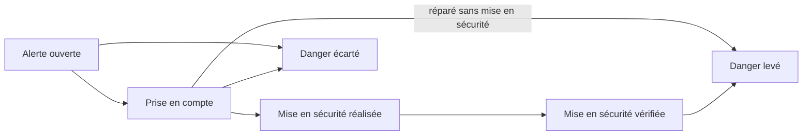

# Cadrage US-10 — Danger, attentes et relances

Statut : cadrage de l'agent (2 novembre 2026), **décisions du porteur reçues le 2 novembre 2026** (réponses Q1 à Q12 en section 4, reportées dans REGLES « Danger, attentes et relances — US-10 » et PERMISSIONS). Les propositions marquées « agent » restent des choix de l'agent, révisables. Aucun service n'est acheté ni configuré : l'e-mail et le SMS (S10-09) attendent l'achat du porteur. Sous-cartes S10-01 à S10-10 (sans S10-06) créées dans Trello le 02/11 (§3).

**En bref, décisions du 02/11 :** pas de push avant la tablette (Q1-B : centre de notifications seul côté web, push natif avec US-13, RG-08 push reporté à US-13) ; e-mail pour les dangers et les escalades, SMS pour les dangers (Q2-D, bloqué par l'achat et la collecte des numéros de mobile) ; **tant que cet achat n'est pas fait, une alerte de danger n'est visible que dans le centre de notifications web, au chargement d'une page** ; alerte aux R/D et P/C du site, aux techniciens en charge (Q3-A) ; prise en compte, re-alerte à 15 min puis toutes les heures jour et nuit (Q4-A) ; mise en sécurité déclarée par T, R/D, P/C et vérifiée par R/D (Q5-A) ; pas d'attente sous danger non maîtrisé (Q6-A) ; délai de prise en charge de la qualification au démarrage (Q7-A) ; rappels « à qualifier » à 24 h (Q8-A) ; réexamen à 8 h, escalade à J+3 puis hebdomadaire (Q9-A) ; relance du prestataire via son référent interne et trace hors application (Q10-A) ; heures calmes 21 h – 7 h hors danger (Q11-A) ; cœur et rappels du préventif (Q12-A).

Sources : PRD §5.2, §5.3 et §6 ; REGLES RG-05, RG-07, RG-08, DEC-03, DEC-05, sections US-09, US-11 et US-12 ; PERMISSIONS (ligne « Relancer », décision du 28/10) ; PROCESSUS (mise en sécurité, inspection) ; RECETTE T-03.11, T-03.18 à T-03.20, T-04, T-05.11 ; CONTRATS (dossiers, interventions, attente, intégrations e-mail et push) ; ADR-06 (proposée), ADR-08, ADR-10 ; cadrage US-12 (§2 et §5 : notifications et planificateur renvoyés à US-10).

---

## 0. Ce que couvre US-10 et ce qui est déjà livré

### 0.1 Périmètre du backlog
BACKLOG : « Alerte immédiate ; attente datée suspend délai ; réexamen et escalade sans doublon ; push et centre » (RG-05, RG-07, RG-08 ; tests T-04). Charge du backlog : 8 à 13 j-p, dépendance US-09 (livrée).

### 0.2 Déjà en place (vérifié dans le code de `main`, 8729eab)
| Sujet | Livré par | État réel |
| --- | --- | --- |
| Danger déclaré par le public | US-08 | Choix « Il y a un danger » du formulaire ; `AlerteDanger` enregistrée **dans la même transaction** que le dépôt (`ServiceDepotPublic`) ; consigne affichée au déclarant : depuis la PR #101 (02/11), « Votre signalement est enregistré et transmis aux responsables du site. En cas de danger immédiat, appelez les secours (18 ou 112) », puis le numéro d'urgence du site s'il est saisi par l'administrateur. |
| Danger déclaré par un compte interne | US-09 | Case « danger » et « activité bloquée » de la déclaration interne ; alerte enregistrée (`ServiceDossiers`). |
| Danger relevé en inspection | US-12 | Point « Défaut, danger » ou observation « danger » : une `AlerteDanger` par constat, rattaché ou non (T-03.20) ; le dossier passe « danger » ; marque « nouveau constat » pour R/D. |
| Affichage du danger | US-09 | Étiquette « Danger » sur la carte du suivi des dossiers et « Danger signalé » sur la fiche. Aucune liste « dangers en cours » par site. |
| Priorités et délais DEC-05 | US-09 | Priorité fixée à la qualification ; `echeancePriseEnCharge` = **affectation** + délai (tant qu'aucune intervention n'a démarré) ; `echeanceResolution` = qualification + délai + attentes ; calcul à la lecture ; carte « en retard » et délai restant affichés. |
| Attente | US-09 (S09-03) | Motif (liste DEC-03), commentaire, **date de réexamen obligatoire** (aujourd'hui à un an) ; délai de résolution suspendu, durée d'attente cumulée, ancienneté conservée ; « réexamen le … » affiché. Rien ne se passe à la date de réexamen. |
| Clôture « Mesure provisoire » | US-09 | État final « Mesure provisoire (mis en sécurité, à reprendre) » d'une intervention. Aucun suivi de mise en sécurité. |
| Droit « Relancer » | US-06 | `Droit.Relancer` = Responsable, Délégué, Pasteur, Coordination (`MatriceDroits`) ; le technicien ne l'a pas (décision du 28/10). Aucune opération ne l'utilise. |
| Destinataires | US-06 | `IAnnuaireMembres.MembresAyantDroitAsync(site, droit)` liste les membres actifs d'un site ayant un droit, avec leurs rôles : sert déjà aux intervenants (US-09) et aux plans préventifs (US-12). Les comptes ont une adresse e-mail (identifiant de connexion), **aucun numéro de téléphone**. |
| Préventif | US-12 | Échéances « À faire / En retard » calculées à la lecture ; « aucune notification envoyée (US-10) ». |

### 0.3 Ce qui n'existe pas
- **Aucune diffusion** : pas de centre de notifications, pas de push, pas d'e-mail. `AlerteDanger` est écrite puis jamais lue.
- **Aucun planificateur** : ni `BackgroundService`, ni déclencheur planifié Cloudflare ; le conteneur se met en veille après 15 min sans requête (`deploy/cloudflare/src/index.ts`) ; les rôles PostgreSQL sont `NOBYPASSRLS` (une tâche qui parcourt toutes les organisations n'a ni organisation ni auteur).
- **Aucune file d'émission après transaction** : ADR-06 (journal d'événements à traiter) est proposée, non adoptée.
- **Aucun service d'envoi** : ADR-08 a reporté l'e-mail (Resend cité) à US-18 ; l'application Flutter n'a ni Firebase ni push ; la préproduction n'a pas de nom de domaine propre (adresse `workers.dev`).

### 0.4 Écarts avec le PRD et les règles validées
1. **Promesse non tenue au déclarant public — corrigée le 02/11 (PR #101, décision du porteur).** L'accusé disait « Les responsables du site sont alertés » (`Signaler.razor`) alors que personne n'est prévenu tant qu'un R/D n'ouvre pas le suivi des dossiers. Trois textes publics changés, sans changement de mise en page : l'accusé (« Votre signalement est enregistré et transmis aux responsables du site. En cas de danger immédiat, appelez les secours (18 ou 112) », puis le numéro d'urgence du site s'il existe) ; la tuile « Il y a un danger » de `Choix.razor` (« L'équipe est alertée en priorité » devient « Danger immédiat : appelez d'abord le 18 ou le 112. ») ; l'en-tête du formulaire de danger (« L'équipe sera alertée en priorité » devient « En cas de danger immédiat, appelez d'abord les secours (18 ou 112). »). Un test refuse désormais toute promesse d'alerte (« alerté », « prévenu », « averti ») sur ces pages ; à revoir quand l'e-mail et le SMS (S10-09) partiront réellement.
2. **RG-05 / PRD §5.2** : « alerte immédiate aux responsables du site avant qualification » : enregistrée, non diffusée. « Suivi de la mise en sécurité distinct de la réparation » (PROCESSUS : à traiter → action réalisée → vérification) : absent. « Contacts et consignes configurés avec l'organisation » : seul le numéro d'urgence existe.
3. **RG-07 / PRD §5.2** : « relancer à la date prévue » : la date de réexamen est stockée, sans effet.
4. **RG-08 / DEC-05** : rappels à 75 %, escalade à 100 %, rappel quotidien : non faits ; seul l'affichage « en retard » existe.
5. **PRD §5.3** : « push sur les tablettes » : l'application tablette n'existe pas encore (US-13). Décision Q1-B : pas de push avant elle, push natif décidé avec US-13 ; d'ici là, centre de notifications seul côté web.
6. **Relances manuelles** (PRD §5.3, PERMISSIONS) : droit présent, aucune opération.
7. **DEC-03 et PROCESSUS « Inspection »** : « R/D sont notifiés » à la clôture automatique d'un dossier (T-03.11) et au rattachement d'un constat d'inspection (T-03.19) : non fait.
8. **Divergence entre RECETTE et le code sur le délai de prise en charge.** T-04.10 attend un rappel aux R/D 3 h après la **qualification** d'un dossier Urgent **non affecté** ; le code (S09-02, CONTRATS) fait partir ce délai de l'**affectation**. Un dossier qualifié mais jamais affecté n'a donc aujourd'hui aucune échéance de prise en charge. À trancher (Q7).
9. **Dossier jamais qualifié** : sans priorité, il n'a aucune échéance (DEC-05 ne fixe pas de délai de qualification) ; un dépôt sans danger peut rester « À qualifier » indéfiniment sans rappel (Q8).

---

## 1. Règles proposées (statut P)

Point de vue retenu : exploitant d'un ERP de type V (lieu de culte), en pratique d'électricien, d'entreprise du bâtiment et de contrôleur technique. **L'application n'est ni un système de sécurité incendie ni une alarme** : elle ne remplace jamais l'appel des secours (18 / 112), le numéro d'urgence du site ni les consignes affichées dans le bâtiment. Elle trace, prévient et relance.

### 1.1 Danger
**Situations visées** (exemples d'expert, pour les libellés et les consignes) : électricité (câble dénudé, tableau chaud ou odeur de brûlé, eau sur une installation), chute de matériaux (pierre, enduit de voûte, ardoise, vitrail, lustre), gaz (odeur), départ de feu ou fumée, structure (fissure évolutive, plancher ou garde-corps du clocher), issue de secours bloquée, éclairage de sécurité ou alarme hors service pendant l'accueil du public, cloches et beffroi.

**Cycle proposé** (suivi parallèle au dossier, PROCESSUS) :

- **Alerte ouverte** : à la création (dépôt public, déclaration interne, constat d'inspection), avant toute qualification (RG-05). Diffusion immédiate aux destinataires de la Q3 (R/D, P/C du site, techniciens en charge) : centre de notifications ; e-mail et SMS quand S10-09 sera faite (Q2-D). D'ici là, l'alerte n'est visible qu'au chargement d'une page de l'application. Objectif technique (agent) : envoi parti moins d'une minute après l'enregistrement, mesuré en préproduction ; aucun report par les heures calmes (Q11).
- **Prise en compte** : un R/D indique « Je prends en compte » ; c'est lui qui suit le danger. Re-alertes et rappels de la Q4 tant que personne ne l'a fait.
- **Mise en sécurité réalisée** : action choisie dans une liste fermée, commentaire, photo facultative ; qui peut la déclarer : Q5. Liste proposée (agent, révisable) : accès condamné ou balisé ; public tenu à distance, zone interdite ; énergie coupée (électricité, gaz ou eau) ; évacuation ; protection ou étaiement provisoire ; secours appelés ; autre (commentaire obligatoire). Quand l'action est « énergie coupée », l'écran rappelle qu'une consignation électrique est réservée à une personne habilitée (NF C 18-510) : l'application ne vérifie pas l'habilitation.
- **Mise en sécurité vérifiée** : par un R/D (Q5). Le danger est **maîtrisé**, pas réparé : l'étiquette passe de « Danger » à « Mis en sécurité, à réparer ».
- **Danger levé** : par un R/D, quand la réparation est faite (dossier clôturé « Résolu ») ou constatée ; motif enregistré. La clôture du dossier ne lève pas le danger d'elle-même, et la mise en sécurité ne clôture pas la réparation (PROCESSUS) ; un dossier clôturé dont le danger n'est pas levé reste signalé aux R/D.
- **Danger écarté** : par un R/D, sans mise en sécurité, motif obligatoire (aucun danger constaté, déjà traité, autre avec commentaire). Ce n'est pas un classement sans suite du dossier, qui garde son propre cycle (US-09).
- **Visibilité** : liste « Dangers en cours » en tête du suivi des dossiers et de l'état du site, indépendante du score (T-05.11), pour les comptes internes du site (`ConsulterSite`), jusqu'à la levée ou l'écartement.
- **Priorité** : le danger reste distinct de la priorité (DEC-05, V) ; R/D qualifient comme aujourd'hui.
- **Consigne par site** (PRD §5.2 « contacts et consignes configurés avec l'organisation ») : en plus du numéro d'urgence, un court texte de consigne (500 caractères au plus) saisi par l'administrateur, affiché au déclarant public qui signale un danger et rappelé dans l'alerte. Texte par défaut proposé par l'agent, à relire par le porteur : « Éloignez les personnes de la zone, n'intervenez pas vous-même sur l'installation, appelez le 18 ou le 112 en cas de feu, de fumée, d'odeur de gaz ou de blessé. »
- **Activité bloquée sans danger** (agent, révisable) : notification immédiate aux R/D du site (centre), sans re-alerte ni mise en sécurité.
- **Un même dossier** : plusieurs alertes possibles (dépôt puis constats d'inspection). L'état affiché est celui de l'alerte la moins avancée ; chaque alerte se prend en compte, se met en sécurité et se lève séparément (agent : une seule action R/D peut viser toutes les alertes ouvertes du dossier).

### 1.2 Attentes
Acquis (US-09) : motif, réexamen obligatoire (aujourd'hui à un an), délai de résolution suspendu, ancienneté conservée. Ajouts proposés :
- **Échéance de réexamen** : traitement le jour du réexamen ; destinataires et escalade selon la Q9. Le dossier affiche « Réexamen dépassé » (UI-04 « attente échue »).
- **Reporter le réexamen** (agent) : la personne en charge ou un R/D fixe une nouvelle date (aujourd'hui à un an) avec un commentaire ; journal « ReportReexamen » (ancienne et nouvelle date) ; nombre de reports visible sur la fiche. Le délai reste suspendu ; la reprise reste l'action US-09.
- **Attente et danger non maîtrisé** : Q6.
- Les rappels DEC-05 du délai de résolution sont suspendus pendant l'attente (RG-07) ; seuls les rappels de réexamen s'appliquent.

### 1.3 Rappels et escalades automatiques (DEC-05, V)
- À 75 % d'un délai : rappel à la personne en charge (R/D du site si non affecté ; sinon le technicien affecté, ou le **référent interne** d'un prestataire).
- À 100 % : escalade aux R/D du site, puis un rappel toutes les 24 h tant que le délai est dépassé (T-04.11 : même heure chaque jour).
- Point de départ du délai de prise en charge : Q7. Dossier non qualifié : Q8. Préventif : Q12.
- Un seuil donne **une** notification par destinataire, même si la tâche est rejouée (T-04.11). Clé d'unicité (agent) : destinataire, dossier, délai (prise en charge, résolution, réexamen, qualification), cycle (réouverture = nouveau cycle), seuil, et jour pour le rappel quotidien.
- Changement de priorité : les échéances sont recalculées ; un seuil déjà notifié dans le cycle n'est pas renvoyé ; un seuil devenu dépassé par la requalification part au passage suivant (agent).
- Destinataires calculés **au moment de l'envoi** (membres actuels du site) : un membre révoqué ou sans rôle sur le site ne reçoit plus rien.
- Heures d'envoi sur les canaux externes : Q11 ; le centre enregistre toujours à l'instant exact.

### 1.4 Relances manuelles
- **Qui** : R/D, pasteur et coordination du site (`Relancer`) ; jamais le technicien (décision du 28/10). Une relance ne change pas le statut (DEC-03 : « pasteurs et coordination relancent sans changer le statut » ; T-03.18).
- **Qui est relancé** (agent) : la personne en charge (technicien affecté ou référent du prestataire) ; si le dossier n'est pas affecté, les R/D du site. Relancer un dossier clos ou à soi-même est refusé.
- **Contenu** (agent) : message court obligatoire (500 caractères au plus) ; journal « Relance » du dossier (auteur, destinataires, message) visible par les comptes du site.
- **Fréquence** (agent, révisable) : une relance par dossier et par auteur toutes les 24 h (4 h pour un dossier Urgent ou en danger non maîtrisé) ; au-delà, refus avec la date de la prochaine relance possible.
- **Relance « interne seulement » du pasteur et relance d'un prestataire** : Q10.

### 1.5 Notifications
**Événements proposés** (destinataires entre parenthèses) :
| Événement | Destinataires | Canaux |
| --- | --- | --- |
| Danger signalé | Q3-A : R/D et P/C du site, techniciens en charge d'une intervention ouverte du dossier | Centre ; e-mail et SMS (S10-09) ; jamais différé |
| Danger non pris en compte (15 min, puis toutes les heures) | Q4-A : tous les destinataires de l'alerte | Centre ; e-mail et SMS (S10-09) ; jour et nuit |
| Mise en sécurité non déclarée après prise en compte (toutes les heures ; autres R/D à 4 h) | Q4-A | Centre (agent : e-mail et SMS réservés à l'alerte et à l'absence de prise en compte, lettre de Q2) |
| Activité bloquée (sans danger) | R/D du site | Centre |
| Dossier resté à qualifier (24 h, puis toutes les 24 h) | Q8-A : R/D du site | Centre |
| Affectation d'une intervention | Intervenant, ou référent du prestataire | Centre |
| Rappel 75 %, escalade 100 %, rappel quotidien (DEC-05) | §1.3 | Centre ; e-mail pour les escalades à 100 % (S10-09, heures calmes Q11) |
| Réexamen d'attente atteint (8 h), escalade à J+3, puis hebdomadaire | Q9-A | Centre |
| Relance manuelle | §1.4 | Centre |
| Dossier clôturé automatiquement (T-03.11) | R/D du site | Centre |
| Constat d'inspection rattaché (T-03.19) | R/D du site | Centre |
| Échéance préventive « À faire », « En retard » | Q12-A (S10-10) : personne affectée au plan, sinon R/D du site (agent) | Centre |

Pas de push dans US-10 (Q1-B) : le push natif de la tablette sera décidé avec US-13 et branché sur le même centre.

**Règles communes** (agent, révisables sauf mention) :
- **Centre de notifications = source de vérité** (CONTRATS « Push »). Une entrée par destinataire : type, site, objet (dossier, contrôle), titre, instant, lue ou non. Lecture limitée à l'organisation et aux sites où le destinataire a **encore** le droit au moment de la lecture (NFR-01) ; le lien ouvre l'objet après contrôle des droits (« une URL connue n'accorde aucun droit »).
- **Contenu minimal hors de l'application** : un e-mail ou un SMS (et plus tard un push) porte le type, le site et le numéro du dossier, **jamais** la description, le nom ni le contact du déclarant (DEC-04 ; la description d'un dépôt public peut contenir des données personnelles). Le détail s'ouvre après connexion.
- **L'auteur d'une action n'est pas notifié de sa propre action.**
- **Émission après transaction** (ADR-06, à adopter avec la sous-carte S10-01) : les notifications sont écrites dans la même transaction que l'événement métier ; l'envoi externe part ensuite, avec reprise (3 essais espacés) et état « en file / envoyé / échec » ; un échec d'envoi n'annule jamais l'action métier.
- **Pas de préférences en V1** ; les alertes de danger ne se désactivent pas. Seule exception : le membre peut retirer son numéro de mobile (S10-09).
- **Conservation** : notifications supprimées 6 mois après leur création ; le journal du dossier reste la trace de référence (proposition à reprendre dans DEC-07).
- **Hors connexion** : sans objet tant qu'US-13/US-14 ne sont pas livrées ; l'API du centre servira aussi l'application tablette.

### 1.6 Canaux possibles (aucun n'est acheté ni configuré ici)
Décision du 02/11 : centre seul dans un premier temps (Q1-B, pas de push web) ; e-mail (dangers et escalades) et SMS (dangers) avec S10-09 après l'achat (Q2-D) ; push natif Firebase décidé avec US-13. Le tableau ci-dessous reste l'analyse qui a servi à la décision.

| Canal | Ce qu'il faut | Coût et service externe | Données personnelles | Limites |
| --- | --- | --- | --- | --- |
| Centre dans l'application (web) | Rien de plus | Aucun | Déjà en base | Ne prévient pas quelqu'un qui n'ouvre pas l'application ; le web en rendu serveur statique ne se met à jour qu'au chargement d'une page |
| **Push web** (navigateur, norme Web Push avec clés VAPID) | Un petit script de service (`/sw.js`), l'accord de l'utilisateur sur chaque appareil, une paire de clés VAPID en secret | Aucun achat ni compte ; les messages transitent, chiffrés, par le service de push du navigateur (Google pour Chrome, Mozilla, Apple) | Adresse d'abonnement de l'appareil, liée au compte | Android (Chrome) : reçu application fermée, sauf économie de batterie agressive ; iPhone et iPad : seulement si le site est ajouté à l'écran d'accueil (iOS 16.4 ou plus) ; aucune garantie de remise |
| Push natif de l'application tablette (Firebase Cloud Messaging) | Projet Firebase, configuration Android, application US-13 | Service Google gratuit, compte à créer | Jeton d'appareil | Pas avant US-13 |
| **E-mail** transactionnel | Un fournisseur d'envoi (Resend cité par ADR-08, ou équivalent hébergé dans l'UE) et **un nom de domaine** avec SPF, DKIM et DMARC | **Achat probable** du domaine (la préproduction n'en a pas) ; offre gratuite limitée chez plusieurs fournisseurs, à vérifier au choix ; compte externe | Adresses e-mail des membres transmises au fournisseur (sous-traitant : contrat et localisation à vérifier) | Remise non garantie (indésirables) ; débloquerait aussi l'envoi des liens d'activation (ADR-10, risque de préemption d'adresse) |
| SMS | Un fournisseur SMS, un expéditeur déclaré | **Payant à chaque message** | **Nouvelle donnée** : numéro de mobile de chaque membre concerné | À réserver au danger s'il est retenu |

---

## 2. Hors périmètre
- **Indicateurs et tableaux de bord** (temps total, attente, hors attente, retards, récurrence) : US-25. Proposition : rattacher T-04.15 (récurrence) à US-25.
- **Tout push** (web ou natif) et notifications sur la tablette hors connexion : US-13 / US-14 (Q1-B).
- **Comptes prestataires** et envoi de messages aux prestataires, sauf décision contraire en Q10.
- **Envoi des PDF finance par e-mail** : US-18 (le fournisseur d'e-mail choisi pour S10-09 sera réutilisé).
- **Appel téléphonique automatique, sirène, lien avec le SSI ou un télésurveilleur** : exclus ; l'application n'est pas un système d'alarme.
- **Préférences fines de notification** (par type, par site) : après le pilote.
- **Rapports de mise en sécurité** et registre de sécurité : US-25.

---

## 3. Découpage révisé après les décisions du 02/11 (sous-cartes de 1 à 5 j-p)

Charge : **18 à 25 j-p** pour le cœur (S10-01 à S10-05, S10-07, S10-08), **19 à 27 j-p** avec les rappels du préventif (S10-10, Q12-A), **22 à 32 j-p** avec l'e-mail et le SMS (S10-09, bloquée par l'achat), contre **8 à 13 j-p** au backlog. L'estimation du backlog ne comptait ni le planificateur (absent du socle), ni le suivi de mise en sécurité, ni les écrans. **S10-06 (push web) est retirée** (Q1-B) : le push natif sera décidé avec US-13. La correction de l'accusé du dépôt public, prévue en S10-08, est faite (PR #101).

Placement Trello au 02/11 : « Prêt » pour S10-01 et S10-07 (aucune dépendance) ; « À affiner » pour les cartes qui attendent une autre sous-carte (passage en « Prêt » quand leurs dépendances sont fusionnées) ; « Bloqué » pour S10-09 (achat et numéros de mobile).

**S10-01 — Centre de notifications et émission après transaction** (backend, 3 à 4 j ; Trello « Prêt »)
- Tables `notifications` (une par destinataire, RLS, clé d'unicité §1.3) et file d'envoi (ADR-06) ; destinataires par `IAnnuaireMembres` ; interface d'envoi remplaçable (centre seul dans cette carte ; e-mail et SMS branchés par S10-09).
- `GET /me/notifications` (non lues, pagination), `POST /me/notifications/{id}/read`, `POST /me/notifications/read`.
- Événements immédiats : danger signalé (dépôt public, déclaration interne, constat d'inspection), activité bloquée, affectation, clôture automatique, constat rattaché.
- Critères : un danger déposé crée une notification pour chaque destinataire de Q3-A (R/D et P/C du site, techniciens en charge d'une intervention ouverte du dossier), dans la même transaction que le dépôt ; rejeu du même `commandeId` : aucune notification de plus ; un membre révoqué ne voit plus ses notifications ; une autre organisation reçoit 404 ; aucun nom ni contact de déclarant dans la notification ; l'auteur n'est pas notifié de sa propre action ; T-03.11 et T-03.19 (« R/D notifiés ») verts.
- Dépendances : aucune. Revue : `/code-review high`.

**S10-02 — Planificateur, rappels DEC-05 et délai de prise en charge** (backend et Worker, 4 à 5 j ; Trello « À affiner »)
- Réveil par **alarme du Durable Object** à la prochaine échéance connue (le conteneur ne reste pas allumé pour rien), plus un déclencheur planifié quotidien de secours ; point d'entrée interne sur le port de l'API, jamais relayé par le Worker, protégé par un secret.
- Parcours des organisations sans contourner l'isolation : une fonction `SECURITY DEFINER` ne renvoie que les identifiants d'organisations ayant une échéance due, puis traitement organisation par organisation avec `SET LOCAL` habituel ; verrou par organisation (alarme et secours simultanés).
- Rappels 75 %, escalade 100 %, rappel quotidien. **Q7-A** : le délai de prise en charge court de la qualification au démarrage de la première intervention (rappel aux R/D tant que le dossier n'est pas affecté, puis à l'intervenant) ; code d'US-09, CONTRATS (`echeancePriseEnCharge`), tests d'US-09 et `deploy/verification/us09.mjs` mis à jour.
- Critères (horloge contrôlée, `TimeProvider`) : T-04.10, T-04.11, T-04.13, T-04.14 ; un dossier qualifié jamais affecté reçoit son rappel ; un dossier en attente ne reçoit aucun rappel de résolution ; une tâche rejouée deux fois ne double rien ; un dossier réaffecté envoie le rappel suivant au nouvel intervenant ; changements d'heure testés.
- Dépendances : S10-01. Revue : `/code-review high` + `/security-review` (point d'entrée interne, fonction `SECURITY DEFINER`).

**S10-03 — Attentes échues et dossiers à qualifier** (backend, 1 à 2 j ; Trello « À affiner »)
- **Q9-A** : le jour du réexamen à 8 h (heure de Paris), rappel à la personne en charge ; sans reprise ni report à J+3, escalade aux R/D du site ; puis un rappel hebdomadaire aux deux. « Reporter le réexamen » (§1.2). **Q8-A** : dossier resté « À qualifier » : rappel aux R/D 24 h après la réception, puis toutes les 24 h tant qu'il n'est pas qualifié, classé ou rattaché.
- Critères : une attente au réexamen du jour notifie la personne en charge une seule fois ; escalade à J+3 puis hebdomadaire ; le report trace l'ancienne et la nouvelle date ; une reprise arrête les rappels ; PRD §14 « déclenche la relance à la date de réexamen ».
- Dépendances : S10-02.

**S10-04 — Danger : prise en compte, mise en sécurité, levée** (backend, 4 à 5 j ; Trello « À affiner »)
- Cycle §1.1 ; **Q4-A** : prise en compte par un R/D ; sans prise en compte en 15 min, nouvelle alerte à tous les destinataires, puis toutes les heures jour et nuit ; après prise en compte et tant que la mise en sécurité n'est pas déclarée, rappel horaire à celui qui l'a prise en compte et aux autres R/D au bout de 4 h. **Q5-A** : mise en sécurité déclarée par T, R/D, P/C du site, vérifiée par un R/D. **Q6-A** : mise en attente refusée tant que la mise en sécurité n'est pas déclarée réalisée. Consigne par site ; liste « dangers en cours ».
- Critères : RG-05 et T-04 « danger avant qualification » ; un dossier clôturé dont le danger n'est pas levé reste dans « dangers en cours » ; T-05.11 ; la prise en compte arrête les re-alertes ; deux prises en compte simultanées : une seule retenue (409) ; pasteur accepté pour déclarer la mise en sécurité, refusé pour la vérifier (403) ; attente refusée sous danger non maîtrisé ; journal de chaque étape (auteur, instant, action, motif) ; non-régression US-08, US-09, US-12.
- Dépendances : S10-01, S10-02 (re-alertes). Revue : `/code-review high`.

**S10-05 — Relances manuelles** (backend, 1 à 2 j ; Trello « À affiner »)
- `POST …/cases/{id}/reminders` (droit `Relancer`), §1.4. **Q10-A** : toute relance vise un compte interne (référent du prestataire) ; R/D et coordination peuvent noter « prestataire relancé hors application » (date, moyen, commentaire), trace seule, sans message ni coordonnées du prestataire ; le pasteur ne fait que des relances internes.
- Critères : technicien refusé (403) ; pasteur accepté sans changement de statut (T-03.18) ; pasteur refusé pour la trace hors application (403) ; seconde relance dans le délai refusée ; journal « Relance » ; dossier clos refusé.
- Dépendances : S10-01.

**S10-07 — Maquettes** (UX, 1 à 2 j ; Trello « Prêt ») : cloche et centre de notifications ; bandeau « Dangers en cours » ; panneau du danger sur la fiche (prendre en compte, mise en sécurité, vérifier, lever ou écarter) ; relance et trace « prestataire relancé hors application » ; attente échue et report ; consigne du site. Pas d'écran d'activation du push (Q1-B). **Plusieurs propositions en Jour et Nuit, puis arrêt pour validation par le porteur avant tout code d'écran.**

**S10-08 — Écrans web et préproduction** (web, 4 à 5 j ; Trello « À affiner »)
- Écrans validés en S10-07 ; déploiement (migrations, alarme et déclencheur) ; `deploy/verification/us10.mjs` : dépôt avec danger → notification d'un R/D au chargement de page → prise en compte → mise en sécurité → vérification ; relance par un pasteur ; attente au réexamen du jour notifiée par le passage du planificateur ; captures téléphone, Jour et Nuit, aucune violation de CSP. Les seuils horaires DEC-05 sont prouvés par les tests à horloge contrôlée, pas en préproduction.
- Dépendances : S10-01 à S10-05, S10-07.

**S10-09 — E-mail et SMS** (backend et web, 3 à 5 j ; Trello « Bloqué » : achat et numéros de mobile)
- **Q2-D** : e-mail pour les dangers (alerte, absence de prise en compte) et les escalades à 100 % ; SMS pour les dangers ; fournisseurs derrière l'interface d'envoi, domaine et SPF/DKIM/DMARC, états d'envoi (CONTRATS « Email »), reprise, contenu minimal (§1.5). **Q11-A** : heures calmes 21 h – 7 h (heure de Paris) pour l'e-mail hors danger, envoi reporté à 7 h ; le danger part toujours.
- Numéros de mobile (données personnelles nouvelles) : base légale à fixer avec le porteur (DEC-07) avant toute collecte ; information des membres au moment de la saisie ; minimisation (numéro facultatif, saisi par le membre lui-même, utilisé seulement pour les SMS de danger, jamais affiché aux autres membres) ; droit de retrait à tout moment ; suppression à la révocation du compte ; transmission au seul fournisseur de SMS (contrat de sous-traitance, localisation).
- Critères : un danger déposé part par e-mail et SMS aux destinataires de Q3-A en moins d'une minute (mesuré en préproduction) ; une escalade de nuit part à 7 h ; un échec d'envoi n'annule jamais l'action métier ; aucun nom, contact ni description de déclarant dans un e-mail ou un SMS ; le numéro retiré n'est plus utilisé ; rappel de la recherche « alerté » du test de l'accusé public à revoir (le texte public peut alors annoncer l'alerte).
- **Bloquée tant que le porteur n'a pas acheté le domaine et ouvert les comptes des fournisseurs d'e-mail et de SMS.** Dépendances : S10-01, S10-04, achat. Revue : `/code-review high` + `/security-review`.

**S10-10 — Rappels du préventif** (backend, 1 à 2 j ; Trello « À affiner » ; Q12-A) : notifications à l'ouverture de la fenêtre « À faire » et au passage « En retard » (US-12), même planificateur ; destinataires : personne affectée à l'échéance, sinon R/D du site (agent) ; une notification par seuil et par échéance. Dépendances : S10-02.

Ordre : S10-01 et S10-07 d'abord ; S10-01 → S10-02 → S10-03 et S10-10 ; S10-04 et S10-05 après S10-01 (S10-04 après S10-02 pour les re-alertes) ; S10-08 après les maquettes validées et les cartes backend ; S10-09 dès que l'achat est fait.

---

## 4. Questions pour le porteur (QCM, une décision par question) — réponses du 02/11

Marques : **[achat]** dépense à autoriser ; **[externe]** service externe à créer ou à configurer ; **[données]** données personnelles nouvelles ou transmises à un tiers.

**Q1. Push des notifications (RG-08 validé : « notifications internes et push »), alors que l'application tablette n'existe pas encore** [externe]

**Réponse du porteur (02/11) : B.** Centre de notifications seul côté web ; push natif (Firebase) décidé avec US-13 ; RG-08 (push) reporté à US-13 ; sous-carte S10-06 (push web) retirée.
- A. **(Recommandé)** Push web du navigateur dès US-10 (clés VAPID, sans compte ni achat ; les messages chiffrés transitent par le service du navigateur : Google pour Chrome). L'utilisateur l'active sur chacun de ses appareils. Le push natif de l'application tablette sera décidé avec US-13. *Fonctionne tout de suite sur les tablettes Android et les téléphones.*
- B. Pas de push avant l'application tablette : push natif Firebase avec US-13 (compte Google Firebase à créer) ; en attendant, centre de notifications seul.
- C. Push web maintenant et push natif Firebase dès US-13, les deux gardés ensuite.

**Q2. Canal en plus du centre et du push** [achat] [externe] [données]

**Réponse du porteur (02/11) : D.** E-mail pour les dangers et les escalades, plus SMS pour les dangers ; achat (domaine, fournisseurs d'e-mail et de SMS) et collecte des numéros de mobile à faire par le porteur : S10-09 « E-mail et SMS » bloquée d'ici là. **Tant que l'achat n'est pas fait, une alerte de danger n'est visible que dans le centre de notifications web, au chargement d'une page.**
- A. **(Recommandé)** E-mail **seulement** pour les dangers (alerte, absence de prise en compte) et les escalades à 100 %, dans une sous-carte à part (S10-09) qui ne bloque pas le reste. Cela demande un nom de domaine (achat), un fournisseur d'e-mail (compte externe, offre gratuite probable à vérifier) et la transmission des adresses des membres à ce fournisseur. *Un filet si le push n'est pas activé ; servira aussi aux liens d'activation et à US-18.*
- B. E-mail pour toutes les notifications (mêmes conditions que A, plus de volume).
- C. Aucun canal en plus en V1 : centre et push seulement.
- D. Comme A, plus un SMS pour les dangers : coût à chaque message, fournisseur SMS, et numéro de mobile des membres à collecter.

**Q3. Qui reçoit une alerte de danger**

**Réponse du porteur (02/11) : A.**
- A. **(Recommandé)** Les R/D du site (pour agir) et les pasteurs et coordinateurs du site (pour information : souvent sur place pendant l'accueil du public, ils peuvent faire évacuer ou fermer l'accès) ; les techniciens seulement s'ils sont en charge d'une intervention ouverte du dossier.
- B. Les R/D du site seulement.
- C. Tous les comptes internes du site, techniciens compris.

**Q4. Suivi d'une alerte de danger dans le temps**

**Réponse du porteur (02/11) : A.**
- A. **(Recommandé)** Un R/D prend en compte l'alerte. Sans prise en compte en 15 min : nouvelle alerte à tous les destinataires, puis toutes les heures, jour et nuit. Après prise en compte, tant que la mise en sécurité n'est pas déclarée réalisée : rappel toutes les heures à celui qui l'a prise en compte, et aux autres R/D au bout de 4 h.
- B. Comme A avec des pas plus longs : 30 min, puis toutes les 2 h ; rappel de mise en sécurité toutes les 4 h.
- C. Aucune prise en compte : une seule alerte, le suivi se fait à l'écran.

**Q5. Mise en sécurité : qui déclare l'action, qui la vérifie**

**Réponse du porteur (02/11) : A.**
- A. **(Recommandé)** L'action réalisée (liste §1.1) est déclarée par un technicien, un R/D, **ou un pasteur ou coordinateur du site** (mesures conservatoires simples : fermer ou baliser l'accès, éloigner le public). La vérification est faite par un R/D. *La personne sur place peut tracer ce qu'elle a fait ; un responsable confirme.*
- B. Déclaration par un technicien ou un R/D seulement ; vérification par un R/D.
- C. Déclaration et vérification par un R/D seulement.

**Q6. Mettre en attente un dossier dont le danger n'est pas maîtrisé**

**Réponse du porteur (02/11) : A.**
- A. **(Recommandé)** Refusé tant que la mise en sécurité n'est pas déclarée réalisée (« Mettez d'abord en sécurité »). *Une attente de livraison ou de devis ne doit pas laisser un danger ouvert sans mesure.*
- B. Permis, avec un avertissement et l'alerte qui reste affichée.
- C. Permis sans condition.

**Q7. Point de départ du délai de prise en charge (T-04.10 et le code divergent)**

**Réponse du porteur (02/11) : A.** Code d'US-09, CONTRATS, tests d'US-09 et `us09.mjs` mis à jour dans S10-02.
- A. **(Recommandé)** De la qualification jusqu'au démarrage de la première intervention : rappel aux R/D tant que le dossier n'est pas affecté, puis à l'intervenant une fois affecté (conforme à T-04.10 et T-04.14). *Un dossier qualifié mais jamais affecté est relancé.* Les échéances affichées des dossiers en cours changent.
- B. De la qualification jusqu'à l'affectation seulement ; le démarrage n'est pas suivi.
- C. Garder le code actuel (de l'affectation au démarrage) et corriger T-04.10 : un dossier qualifié non affecté n'a pas de délai de prise en charge.

**Q8. Dossier resté « À qualifier » (sans danger ; DEC-05 ne fixe pas ce délai)**

**Réponse du porteur (02/11) : A.**
- A. **(Recommandé)** Rappel aux R/D du site 24 h après la réception, puis un rappel toutes les 24 h tant qu'il n'est pas qualifié, classé ou rattaché.
- B. Rappel au bout de 3 jours, puis toutes les 24 h.
- C. Aucun rappel : le nombre de dossiers à qualifier est seulement affiché.

**Q9. Date de réexamen d'une attente atteinte**

**Réponse du porteur (02/11) : A.**
- A. **(Recommandé)** Le matin du réexamen (8 h, heure de Paris) : rappel à la personne en charge. Sans reprise ni report 3 jours plus tard : escalade aux R/D du site, puis un rappel par semaine aux deux tant que rien n'est fait.
- B. Le matin du réexamen : rappel à la personne en charge **et** aux R/D, puis tous les jours.
- C. Un seul rappel à la personne en charge, sans escalade.

**Q10. Relance d'un prestataire extérieur (PERMISSIONS : « P : relance interne seulement »)**

**Réponse du porteur (02/11) : A.**
- A. **(Recommandé)** Toute relance dans l'application vise un compte interne (le référent du prestataire) ; R/D et coordination peuvent en plus noter « prestataire relancé hors application » (date, moyen, commentaire), trace seule, sans message envoyé ni coordonnées du prestataire enregistrées. Le pasteur ne fait que des relances internes.
- B. R/D et coordination envoient un e-mail au prestataire depuis l'application [externe] [données] : adresse du prestataire à enregistrer, fournisseur d'e-mail de la Q2 requis.
- C. Aucune notion de relance externe : toutes les relances sont internes, pour tous.

**Q11. Heures calmes pour le push et l'e-mail (hors danger)**

**Réponse du porteur (02/11) : A**, appliquée à l'e-mail et au SMS (pas de push dans US-10) ; le danger part toujours.
- A. **(Recommandé)** De 21 h à 7 h (heure de Paris), les rappels, escalades et relances qui ne concernent pas un danger partent à 7 h ; le centre les enregistre à l'heure exacte et les délais DEC-05 ne changent pas. Les alertes de danger partent toujours immédiatement.
- B. Aucune heure calme : envoi à l'heure exacte, nuit comprise (temps calendaire strict).
- C. Comme A, et rien le dimanche avant 13 h (offices).

**Q12. Périmètre et charge (21 à 34 j-p contre 8 à 13 au backlog)**

**Réponse du porteur (02/11) : A.**
- A. **(Recommandé)** Le cœur S10-01 à S10-08 (21 à 29 j-p), plus les rappels du préventif S10-10 (1 à 2 j) ; l'e-mail S10-09 selon Q2, lancé quand l'achat et le compte sont faits.
- B. Le cœur seulement ; les rappels du préventif reportés après US-10 (US-12 garde ses listes « À faire / En retard »).
- C. Premier incrément réduit : centre, danger (alerte, prise en compte, mise en sécurité) et relances, sans planificateur ni push ; rappels DEC-05, attentes échues et push dans un second temps. *Contraire à RG-08 tant que le second temps n'est pas fait.*

---

## 5. Risques et inconnues
- **Danger enregistré, pas diffusé hors de l'application.** Texte public corrigé le 02/11 (PR #101, §0.4). Mais tant que l'achat e-mail et SMS (S10-09) n'est pas fait, une alerte de danger n'est visible que dans le centre de notifications web, au chargement d'une page : un R/D qui n'ouvre pas l'application n'est pas prévenu. Le porteur l'a accepté (Q1-B, Q2-D) ; à rappeler en recette et lors de la mise en service d'un site.
- **Coût du planificateur.** Chaque réveil garde le conteneur allumé au moins 15 min (veille de `index.ts`) : un déclencheur fréquent reviendrait à un conteneur toujours actif (ordre de grandeur noté dans ETAT : environ 28 $/mois en `standard-1`). D'où l'alarme du Durable Object à la prochaine échéance réelle, et un seul déclencheur de secours par jour ; coût à mesurer en préproduction. Ajouter une alarme et un déclencheur modifie la configuration du service Cloudflare existant (sans achat) : à faire dans le cadre du déploiement autorisé à l'agent.
- **Isolation des organisations.** Le planificateur n'a pas d'organisation de requête ; la fonction `SECURITY DEFINER` ne doit exposer que des identifiants d'organisations, jamais de données ; revue de sécurité obligatoire.
- **Fiabilité des canaux externes (S10-09).** Remise d'un e-mail non garantie (indésirables) ; SMS payant à chaque message, et les re-alertes horaires de nuit (Q4-A) multiplient les envois d'un danger non pris en compte : plafond et coût à mesurer dans S10-09. Un danger ne doit jamais dépendre d'un seul canal : consigne et numéro d'urgence restent le premier réflexe.
- **Web sans temps réel.** Le web Blazor en rendu serveur statique ne pousse rien à une page ouverte (ADR-08, ADR-11) : la cloche se met à jour au chargement de page ; rien ne couvre l'immédiat avant S10-09 (e-mail, SMS) et US-13 (push natif).
- **Données personnelles.** Adresses e-mail et numéros de mobile transmis à des tiers (fournisseurs d'e-mail et de SMS) ; numéros de mobile nouvellement collectés (base légale, information, minimisation, retrait : S10-09) ; contenu minimal imposé ; durée de conservation des notifications à confirmer avec DEC-07.
- **Changement du délai de prise en charge (Q7-A).** Les échéances affichées des dossiers ouverts changent sans migration (calcul à la lecture) ; `us09.mjs` et les tests d'US-09 à mettre à jour.
- **Fuseau et heure d'été.** Délais DEC-05 en durées exactes (instants) ; réexamen, heures calmes et rappels « à 8 h » en heure de Paris ; tests aux changements d'heure.
- **Vérification en préproduction limitée.** Les seuils de 3 h ou de 24 h ne se prouvent pas en temps réel : tests à horloge contrôlée, et en préproduction un réexamen « aujourd'hui » pour voir passer le planificateur.
- **Estimation.** Réestimée après les réponses : 19 à 27 j-p sans S10-09, 22 à 32 j-p avec (§3), contre 8 à 13 au backlog.
- **Trello.** Sous-cartes créées le 02/11 (§3) ; US-10 passe en « Prêt » après fusion de ces décisions ; maquettes S10-07 validées par le porteur avant tout code d'écran.
