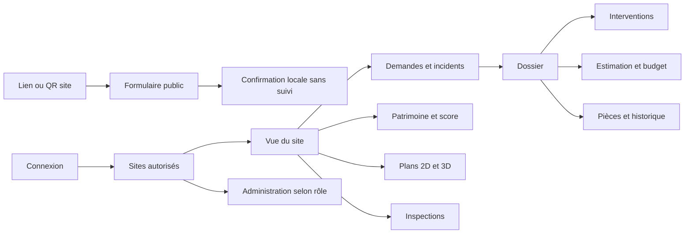

# APPFLOW et écrans annotés
Statut : P de conception. Maquettes textuelles fonctionnelles, pas de design visuel final.

## Navigation

## Écrans de référence
| ID | Écran | Contenu / action principale | États à traiter |
| --- | --- | --- | --- |
| UI-01 | Dépôt public | Site issu du lien, type, nom, contact, emplacement texte, description, danger, photo ; envoyer | Lien invalide, upload échoué, doublon d’envoi, confirmation sans lien de suivi |
| UI-02 | Tableau site | Score /10, libellé, couverture, ancienneté des évaluations, alertes, dossiers à traiter | Non évalué, aucune demande, accès retiré |
| UI-03 | File de qualification | Filtres priorité, ancienneté, zone ; ouvrir et affecter | Danger avant qualification, doublon, sans suite |
| UI-04 | Dossier | Constat, photos, état, affectation, actions, attente, estimation, historique | Modification concurrente, attente échue, réouverture |
| UI-05 | Fiche composant | Catégorie, quantité, dernier état, évaluations et mesures ; évaluer | Lot partiellement évalué, grille modifiée, composant retiré |
| UI-06 | Mes interventions tablette | Téléchargements, statut de synchronisation, profil actif | Hors connexion, expiration 24 h, données non synchronisées |
| UI-07 | Grille terrain | Critères, unités, notes, photos ; enregistrer | Saisie partielle, danger, champ invalide |
| UI-08 | Proposition IA | Sources, hypothèses, matériel, main-d’œuvre, alternatives ; corriger | Information manquante, fournisseur indisponible, analyse échouée |
| UI-09 | Autorisation | Total, enveloppe, disponible, exceptionnel, justificatif ; réserver | Solde changé depuis ouverture, finance attendue |
| UI-10 | Plan | Niveau, pièce, position/précision ; recalage puis sélection | Plan absent, position ancienne, hors connexion |
| UI-11 | Stock | Quantités, seuils, mouvements, transferts | Écart à régulariser, transit, stock physique inconnu |
| UI-12 | Administration | Membres, sites, délégations, support | Révocation, suppléant, abonnement |

## Disposition fonctionnelle proposée
Tableau site : en-tête site et filtre → score et couverture → dangers et retards → file d’actions → accès patrimoine/plans.
Dossier : identité et statut → constat → intervention → pièces/historique ; budget révélé selon rôle.
Tablette : profil et connexion toujours identifiables ; saisie enregistrée localement distinguée de saisie synchronisée.

## Composants UX à uniformiser
Badge d’état avec texte (pas couleur seule), montant/devise, mesure/unité, indicateur de synchronisation, confirmation d’action sensible, erreur corrigible, état vide utile, navigation clavier pour le web.
Charte et thèmes Jour/Nuit validés le 27 octobre 2026 : voir [CHARTE.md](CHARTE.md). Les maquettes des autres écrans et les tests d’utilisabilité suivent cette charte.

